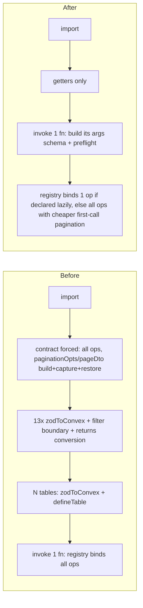

# cvx-kit Module-Load Cost - Plan

---

## Goal Capsule

- **Objective:** Queries and mutations in Convex apps built on cvx-kit respond faster, because importing cvx-kit and registering functions through it no longer costs tens of milliseconds on every request. Validation results stay exactly the same.
- **Means:** Defer schema and validator construction from import to first use (KTD1–KTD5), make the first build of relation pagination schemas cheaper (KTD3), add a reader-only auth constructor that does not need triggers (KTD6), and guard the result with a benchmark and a deterministic regression test (KTD7).
- **Authority:** The user's goal brief for this session is authoritative, then this plan. Repository conventions come from `AGENTS.md`, `CHANGELOG.md` style and the `skills/cvx-kit/references/*` guides.
- **Execution profile:** One branch (`perf/module-load-cost`). One commit per unit after that unit's tests, typecheck and lint pass. Ships as one PR, and only when the user asks. No push, publish or PR without that request.
- **Stop conditions:** Stop and report if a unit can only meet its goal by changing validation outcomes or by breaking an existing public type. Also stop if the full test suite regresses and the cause cannot be fixed inside the unit.
- **Finishing:** The executing agent finishes all units, then runs code, implementation and security reviews on the changed code. The user decides whether to push or publish.

---

## Product Contract

### Summary

Make cvx-kit cheap to import and cheap to register. Builders defer Convex validator conversion until Convex or an invocation asks for it. Relation pagination helpers stop running build, capture and restore on their first call. Table boundaries defer their Convex `defineTable` conversion. Contracts can declare operations lazily, and registries can bind lazily declared operations one at a time. Consumers can build read-only auth constructors without importing their trigger registry. A bench and a deterministic test keep this from creeping back.

### Problem Frame

Convex evaluates a function's whole static import graph on every request, and dynamic `import()` is unsupported in queries and mutations. On Accord's dev deployment (2026-11-11), functions take 280–800ms p50 while their handlers take 0.1–1.6ms. A local bundle of Accord's `api/payments` evaluates in 131ms and retains 28.2MB. `api/search` takes ~76ms and retains 9.0MB. In the payments profile cvx-kit self time is ~32ms, and cvx-kit-driven zod construction accounts for most of zod's ~63ms. The main sources are forcing the domain contract (`paginationOpts` 26ms and `pageDto` 14ms inclusive), registration-time zod→Convex conversion and filter-boundary construction (~19ms), schema-snapshot capture (~9ms), and table definition (`zodTable`, ~9ms). Module state never survives across requests, so recipe caches that pay off on a second call never pay off in production.

### Requirements

**Behavior preservation**

- R1. Every registered function accepts and rejects the same arguments, returns the same parsed results and raises the same validation errors as before.
- R2. Pushed function metadata (`exportArgs`/`exportReturns` JSON) is byte-identical to before for every existing declaration form.
- R3. Existing public types and declaration forms keep compiling unchanged. New capabilities are additive.

**Import and registration cost**

- R4. Registering a function through cvx-kit builders does not convert its zod args or returns to Convex validators, and does not build its filter boundary, until Convex exports the validator or the function is invoked.
- R5. Builders accept `args` and `returns` declared as getters and do not read them until needed. This lets a module register many functions without building their schemas.
- R6. The first call of `relations.tables.<t>.paginationOpts(...)` and `pageDto(...)` does measurably less work than today and returns schemas that behave the same.
- R7. A `zodTable`/`zodVariantTable` boundary does not convert its storage to a Convex table definition until `.table` is read.
- R8. A domain contract whose operations (or their `input`/`result`) are declared as getters builds only the operations that are read, and builds each one at most once.
- R9. A registry bound to such a contract builds the binding for only the operation being executed. Eagerly declared operations keep today's binding and error behavior.

**Auth composition**

- R10. Consumers can create read-only auth constructors (queries and actions) from a config that has no triggers, without any way to obtain trigger-less mutation constructors from it.

**Measurement and guard**

- R11. The repo has a bench that bundles a representative app for the browser target and reports eval ms and retained heap, with recorded baseline and after numbers.
- R12. A deterministic test fails if registration or import starts building validators eagerly again. A thresholded bench script catches timing regressions.

**Documentation**

- R13. `CHANGELOG.md`, `README.md` and the affected `skills/cvx-kit/references/*` guides describe every pattern consumers must adopt to benefit: getter args/returns, lazy contract operations and reader-only auth constructors.

### Success Criteria

- The bench's representative app shows a clear reduction in median eval time and retained heap against the recorded baseline in the same run. The target is at least 30% on the eager variant.
- Accord's `api/payments` and `api/search` bundles, rebuilt against the local dist with no Accord source changes, evaluate faster than the 131ms / 76ms baseline. Numbers are reported for both the unchanged Accord source and an illustrative getter-based variant measured in a temp copy.
- The full test suite, typecheck, lint and the packed-package tests pass at every commit.

### Scope Boundaries

- No dynamic `import()`, no `"use node"`, default Convex V8 runtime only.
- No edits or commits in `/Users/angel/dev/accord`. Accord is measured by bundling its entries with a resolve redirect to the local dist, never by modifying its `node_modules`.
- Pruning Accord's import graph (triggers → domains → schema/relations/AI catalog) belongs to the Accord thread.
- Effect, xstate and evlog: research found `effect` only behind `cvx-kit/effect`, which Accord imports directly. xstate, evlog and mime are not cvx-kit dependencies. This plan documents that finding and does not change packaging.
- Considered and not built: a cross-call `zodToConvex` WeakMap cache. Zod schemas and Convex validators are mutable, and module state does not survive across requests, so the cache would add risk without production benefit. Evidence that would change this is profiled repeated conversion of one schema within a single request.
- Considered and not built: changing `paginationOpts`/`pageDto` to return `z.lazy` or proxy schemas. Research shows `instanceof`/`.shape` reads at registration and in `paginationGrammar` would break (R1, R3).

#### Deferred to Follow-Up Work

- Moving definition-time fail-closed checks in `zodVariantTable` (`assertDtoValidationSchema`, `assertVariantToolField`) to first use.
- Splitting `queryFailureContract` out of `cvx-kit/querying`, so `core.ts`-style imports do not reach the query engine and `@noble/ciphers`.

---

## Planning Contract

### Key Technical Decisions

- KTD1. **Defer registration conversion inside `customFnBuilder` (`src/zod-registration.ts`).** The definition passed to the Convex builder gets memoized `args`/`returns` getters, which compute `addFieldsToValidator(zodToConvex(...))` and `zodOutputToConvex(...)` on first read. The handler builds `argsSchema`, `argsKeys` and the boundary preflight on first invocation from the same memoized state. Convex's `registration_impl` reads `functionDefinition.args`/`returns` only inside the `exportArgs`/`exportReturns` thunks and does not validate in JS at invoke, so this is invisible to Convex. convex-test calls `exportArgs()` per invocation, so tests still exercise it. Cheap structural checks (non-object zod args rejection, `skipConvexValidation` with custom input args) stay at registration when `args` is a plain data property, which keeps their error timing. If a wrapped builder spreads the definition eagerly, the getters run then: laziness is lost, but behavior is unchanged. The per-function state uses `memoize` from `src/modules/contracts/lazy.ts`, which commits only a complete build and rethrows a cached failure, so a failed first build can never leave a later invocation without its parse or preflight. The branch between args and no-args handling is chosen from the descriptor's presence, never from a data value, so an accessor-declared `args` can never fall into the no-args branch and push `v.any()`.
- KTD2. **Read user-supplied `args`/`returns` through property descriptors, not destructuring.** Destructuring and object rest invoke getters. The builder computes `extra` by copying own keys other than `args`, `returns`, `handler` and `skipConvexValidation`, and reads accessor-declared `args`/`returns` only inside the memoized state (R5).
- KTD3. **First-call fast path for relation pagination helpers (`src/relations.ts`).** On a `paginationGrammars` miss, use the freshly built grammar directly for this call instead of build → capture → restore. Capture happens on the second call with the same key (build fresh, capture, return), and materialization from the recipe on the third and later calls. `pageDto` follows the same shift: the first miss returns a fresh graph without `captureDto`, and the second call runs today's miss path, including the audited-environment double check before reusing a captured graph. Each call still returns an independent graph. For `pageDto`, the fast path covers only the case where today's code already returns a fresh graph: ordinary, non-variant pages with no selected relations or field groups, under the `ordinaryDtoConstruction()` check before and after construction. In that case the first call skips `captureDto`. Variant pages and pages with relations or field groups keep today's capture/materialize first call, because `rowSchema` shares relation targets across branches (fix `fd75909`). Further sub-steps are taken only when profiling shows they matter and tests confirm equivalence: the compact double pass, per-call `boundedObject` constructor creation, and a within-call predicate memo. A memo, if added, is keyed by source validator identity and never shared across variant branches or relation occurrences in one returned graph.
- KTD4. **`table` becomes a memoized getter on `zodTable` and `zodVariantTable` boundaries (`src/zod-table.ts`), with a setter matching the existing `replaceBoundaryValue` pattern.** `storage` stays eager, because `crud.ts` and `derived` depend on its identity. Conversion errors such as unsupported array-of-optional move from definition to first `.table` read, which `defineSchema` performs at schema evaluation and push. This timing change is recorded in the CHANGELOG. `defineRelations` (`src/relations.ts`) today requires `table` to be a data descriptor ("Unsupported native table accessor") and builds `nativeSkeleton` per table at definition. Boundaries therefore register their memoized getter in a module-private WeakSet of trusted lazy accessors. `defineRelations` accepts only those accessors, keeps rejecting foreign getters with the existing message, and defers `native` resolution and `nativeSkeleton` to the table's first relation use (`storedTier`/`ready`).
- KTD5. **Lazy contract operations are opt-in through getters.** `defineDomainContract` wraps accessor descriptors found in `commands`/`queries` sections, and in operation objects' `input`/`result`/`replayResult`/`wire`, with memoized getters, so identity is stable and each operation is built at most once. Data-declared contracts are untouched. In registries (`src/modules/contracts/binding.ts`, `snapshotOperations`, `domainHelpers`, `bindDomainImplementation`), per-operation binding applies only to accessor-declared operations. Key-set equality checks stay eager, because they read keys only. Binding validation, the frozen snapshot and audit wrapping for a lazily declared operation run on its first access. Eagerly declared operations keep today's eager snapshot and error timing (R9). The bench re-measures after this unit and reports the invocation-time saving. That measurement is reported, not a condition for building.
- KTD6. **Add `createAuthReaders(config)` in `src/auth.ts`.** It returns `authQuery`, `roleQuery`, `adminQuery`, `systemQuery`, `serviceQuery`, the action constructors, `include` and `authenticatedUser`. Its config type omits `triggers`, `wrapDB` and the mutation builders. It shares the private implementation with `createAuthFunctions`, so behavior is identical. `AuthFunctionsConfig` is typed as the reader config plus `triggers`/`wrapDB`/mutation builders, so one triggers-free base config object type-checks in both. The docs show that base exported once and spread into the write config, so the two modules cannot drift apart on `security` or `verifyMembership`. Mutation constructors exist only on `createAuthFunctions`, which removes the trigger-less-mutation hazard. The Effect auth surface gets a matching reader constructor only if it shares the same config path without extra design work. Otherwise it is deferred.
- KTD7. **Two guards.** (a) A deterministic vitest test (`test/module-load-guard.test.ts`). It registers functions through every builder family and declares tables and contracts, then asserts, through spies or counters on the conversion entry points, that no Convex validator conversion or contract forcing happens until `exportArgs`/`.table`/operation reads. (b) A bench script (`scripts/bench-app-load.mjs`) that bundles `scripts/bench/app-module-load-entry.ts` like Convex does (esbuild, browser, ESM, `convex,module` conditions, as in `scripts/bench-module-load.mjs`), runs N fresh-process imports with `--expose-gc`, reports median eval ms and retained MB, and exits non-zero above thresholds stored in a small JSON file. Timing is not asserted in vitest, because it is too noisy for CI.

### High-Level Technical Design

Per-request cost before and after, for a module that registers 13 functions, of which one is invoked:

### Assumptions

- The user's goal brief authorizes running `ce-work` after this plan without a separate confirmation. Scoping confirmation and the interactive handoff menu were therefore not used.
- Accord's bundles are measured by building its entries with an esbuild resolve plugin that maps `cvx-kit/*` to this worktree's `dist`, with bare imports resolved from Accord's own `node_modules/cvx-kit` directory. This satisfies the brief's "copied dist" option without touching Accord.
- Error-timing moves for invalid definitions (KTD1 conversion errors, KTD4) are acceptable as long as push still fails and invocations still fail identically. The CHANGELOG states them.

### Sources & Research

- Convex `node_modules/convex/dist/esm/server/impl/registration_impl.js`: `exportArgs`/`exportReturns` read the definition lazily, and invoke paths do not validate in JS.
- convex-test `node_modules/convex-test/dist/index.js:2710`: calls `exportArgs()`/`exportReturns()` on each invocation.
- Prior work already in HEAD: `f20ff38` (relation registration and auth startup), `0e12cb7` (deferred table schemas and registry init), 0.1.27 eager-import fixes, and `docs/benchmarks/module-load.md` (invariants: independent graphs per call, audited-environment guard, variant isolation).
- Hot-path map: `src/relations.ts` helpers at the `tables` accessor block (`paginationOpts`, `pageDto`, `filterGrammar`, `captureFilterGrammar`, `restoreFilterGrammar`, `rowSchema`), `src/querying/shared/filters.ts` (`relationFilterSchema`, `filterNodeSchema`, `boundedObject`), `src/querying/schema-snapshot.ts` (`captureDto`, `materializeDto`, `ordinaryDtoConstruction`).
- https://stack.convex.dev/horizontally-scaling-functions, https://docs.convex.dev/functions/bundling, https://github.com/rjdellecese/confect/issues/853.

---

## Implementation Units

### U1. Representative app bench and baseline

- **Goal:** Measure import cost of a representative cvx-kit app and record the baseline before any production change.
- **Requirements:** R11, R12
- **Dependencies:** none
- **Files:** `scripts/bench/app-module-load-entry.ts` (new), `scripts/bench/app-fixture.ts` (new, or extend `scripts/bench/relations-fixture.ts`), `scripts/bench-app-load.mjs` (new), `scripts/bench/app-load-budget.json` (new), `docs/benchmarks/module-load.md`
- **Approach:**
  1. Fixture: ~30 `zodTable`s including two variant tables, `defineRelations` with joins, one domain contract per domain with commands plus two list queries using `paginationOpts` + `pageDto`, and `createAuthFunctions` with a `Triggers` instance, registering ~13 functions per module through `authQuery`/`authMutation` with `args: contract...input`.
  2. Two variants via a define flag, named **eager** (today's data-property consumer form) and **getter** (`get args()` plus lazily declared contract operations). The 30% success target applies to the eager variant's median eval ms. The script also reports import plus one simulated invocation: call one function's `exportArgs()` and force its registry operation.
  3. Script output: median/p25/p75 eval ms and retained MB over N fresh processes. It compares against the budget JSON and exits non-zero when over. A `--profile` flag writes a CPU profile.
  4. Record the baseline in `docs/benchmarks/module-load.md`, plus the Accord `api/payments`/`api/search` baseline taken with the resolve-redirect method.
- **Patterns to follow:** `scripts/bench-module-load.mjs` (esbuild settings, interleaved fresh-process runs), `scripts/bench/eager-module-load-entry.ts`.
- **Test scenarios:** Test expectation: none -- measurement tooling. Verified by running it and getting stable numbers (p75/p25 spread within ~10%).
- **Verification:** The script runs from a clean checkout after `bun install`, and baseline numbers are written to the benchmark doc.

### U2. Lazy registration validators

- **Goal:** Builders stop converting args/returns and building filter boundaries at registration (KTD1, KTD2).
- **Requirements:** R1, R2, R3, R4, R5
- **Dependencies:** U1
- **Files:** `src/zod-registration.ts`, `test/zod-registration.test.ts`, `test/zod-registration-types.ts`, `test/module-load-guard.test.ts` (new)
- **Approach:**
  1. Per registered function, a memoized state holds `argsSchema`, `argsKeys`, the boundary and the Convex validators. It is created from the user definition's descriptors.
  2. The definition passed to the Convex builder has accessor `args`/`returns` that read the memoized validators.
  3. The handler resolves the state on first invocation and then behaves exactly as today.
  4. Eager cheap checks stay when `args` is a data property.
- **Test scenarios:**
  - `exportArgs()`/`exportReturns()` JSON for object args, zod-object args, compact pagination args, custom input args and `skipConvexValidation` equals the pre-change output. Capture the expected strings from HEAD before changing code.
  - Registering a function makes no `zodToConvex` call until `exportArgs()` is called (spy), and the getter-declared `args` is not read at registration.
  - Invoking through convex-test with valid args returns the same result. Invalid args raise the same `ConvexError({ZodError})` payload, and compact filter preflight still rejects oversized input.
  - A non-object zod `args` still throws "Unsupported zod type as args validator" at registration.
  - `skipConvexValidation` with custom input args still throws at registration.
  - A getter-declared `args` that throws surfaces its error at `exportArgs()` and at invocation, not at registration.
  - Getter-declared `args`/`returns` meet the same parity checks as data properties: byte-identical `exportArgs()`/`exportReturns()` JSON, the same `ConvexError({ZodError})` on invalid args, compact filter preflight still rejecting oversized input, and undeclared returned fields still stripped by `returns`.
  - A first invocation whose build throws, followed by a second invocation, rethrows the same error. It never runs the handler without parse or preflight.
  - Type test: getter-declared `args`/`returns` infer the same handler arg and return types as data properties.
- **Verification:** Full suite, typecheck and lint pass. The bench shows registration cost removed for the data-property form.

### U3. Cheaper first call for relation `paginationOpts` / `pageDto`

- **Goal:** Cut first-call construction work without changing returned schema behavior (KTD3).
- **Requirements:** R1, R3, R6
- **Dependencies:** U1
- **Files:** `src/relations.ts`, `src/querying/shared/filters.ts` (only if needed), `src/querying/schema-snapshot.ts` (only if needed), `test/relations-lazy.test.ts`, `test/relations-pagination-first-call.test.ts` (new)
- **Approach:**
  1. Count calls per cache key.
  2. First miss: return the fresh build without capture or restore.
  3. Second call: today's miss path, with capture and the audited guard.
  4. Third and later calls: materialize.
  5. For `pageDto`, skip `captureDto` on the first call only in the ordinary fresh-return case from KTD3.
  6. Re-profile with the U1 bench before attempting the compact-pass or `boundedObject` reductions.
- **Execution note:** Add characterization tests first. For a set of selections (scalar only, relation joins, variant table, compact validator, field groups), record parse results for valid and invalid inputs, `zodToConvex` JSON and `toJSONSchema` output on calls 1, 2 and 3. Lock them before changing code.
- **Test scenarios:**
  - Calls 1, 2 and 3 with the same selection return graphs with identical parse outcomes and identical Convex JSON.
  - Mutating the graph returned by call 1 (`.shape` replacement, `.extend`) does not affect calls 2 and 3. The same holds for call 2's graph.
  - Variant-table pages keep branch isolation across calls (the existing 0.1.27 regression tests still pass).
  - Within one call-1 graph of a variant page with a selected relation, mutating the relation validator under one branch does not affect the sibling branch.
  - The compact validator option still produces compact metadata accepted by `compactArgumentBoundary`.
  - An unaudited Zod environment (memoizer or config guard tripped) still takes the materialize path on call 2.
- **Verification:** The bench shows reduced contract-forcing time. All relation, querying and packed querying/variant tests pass.

### U4. Deferred table definition

- **Goal:** `zodTable`/`zodVariantTable` defer `zodToConvex(storage)` + `defineTable` to first `.table` read (KTD4).
- **Requirements:** R1, R2, R3, R7
- **Dependencies:** U1
- **Files:** `src/zod-table.ts`, `src/relations.ts`, `test/zod-table-lazy.test.ts` (new) or the existing zod-table tests, `test/relations-preflight-lazy.test.ts`
- **Test scenarios:**
  - `defineSchema` output (serialized tables and indexes) is identical for plain, tenant, `createTable` and variant tables (legacy and derived).
  - No `zodToConvex` call at definition. `.table` returns the same object on repeated reads.
  - Assigning `.table` follows the existing replace semantics.
  - Unsupported storage shapes throw on first `.table` read with the same message.
  - `createModule` and `defineSchema(createModule(...))` still work.
  - `defineRelations` over lazy boundaries makes no `zodToConvex` call until a relation helper or `.table` is used. A foreign getter `table` is still rejected with "Unsupported native table accessor".
- **Verification:** Full suite plus packed variants tests pass. The eager variant's median eval ms drops.

### U5. Lazy contract operations and per-operation registry binding

- **Goal:** Getter-declared contract operations build only when read, and registries bind them per operation (KTD5).
- **Requirements:** R1, R3, R8, R9
- **Dependencies:** U2, U3. Re-measure after this unit and report the invocation-time saving.
- **Files:** `src/modules/contracts/domain.ts`, `src/modules/contracts/binding.ts`, `src/modules/effect/query.ts`, `src/modules/effect/command.ts`, `src/modules/foundation/foundation.ts` (if it consumes snapshots), `test/domain-contracts.test.ts`, `test/lazy-declarations.test.ts`, `test/domain-contract-types.ts`
- **Test scenarios:**
  - Reading `contract.queries.a.input` does not run the getters of `queries.b` or of `a.result`.
  - Repeated reads return the same schema identity.
  - Thunk contracts containing getter ops are lazy at both levels.
  - A data-declared contract behaves exactly as today, including the error timing for mismatched keys and foreign helpers.
  - For a getter-declared operation, executing op `a` binds only `a`. A binding error in op `b` (e.g. foreign helper) surfaces when `b` is first executed, with the same message.
  - Key-set mismatches between contract and operations still throw on first registry use.
  - A lazily bound command still requires an audit callback, and a failed first binding rethrows on the next execution. It never executes unwrapped.
  - Type test: getter-declared operations infer the same `input`/`result` types and `CheckedDomain` errors.
- **Verification:** Full suite, typecheck and the Effect packed tests pass. The bench getter variant shows invocation-time savings.

### U6. Reader-only auth constructors

- **Goal:** Let consumers build query/action constructors without importing triggers (KTD6).
- **Requirements:** R3, R10, R13
- **Dependencies:** U2
- **Files:** `src/auth.ts`, `test/auth.test.ts`, `test/auth-native-context-types.ts`, `README.md`, `skills/cvx-kit/references/auth.md`
- **Test scenarios:**
  - `createAuthReaders(config)` queries resolve identity, tenancy and rules the same as `createAuthFunctions` queries for the same config (shared convex-test cases).
  - The returned object has no mutation constructors.
  - Passing `triggers` is a type error.
  - Role gating and `adminQuery` behave identically.
  - Actions from readers verify membership the same way.
  - Given one shared base config, readers and `createAuthFunctions` queries apply the same tenancy rules.
- **Verification:** Auth unit tests and `test:package:auth` pass. The docs show the two-module pattern (`functions/read.ts` without triggers, `functions/write.ts` with triggers).

### U7. Regression guard, docs and final measurements

- **Goal:** Lock the gains in and tell consumers what to adopt (KTD7).
- **Requirements:** R11, R12, R13
- **Dependencies:** U2–U6
- **Files:** `test/module-load-guard.test.ts`, `scripts/bench/app-load-budget.json`, `docs/benchmarks/module-load.md`, `CHANGELOG.md`, `README.md`, `skills/cvx-kit/references/domain-contracts.md`, `skills/cvx-kit/references/zod-table.md`, `skills/cvx-kit/references/auth.md`, `skills/cvx-kit/references/querying.md`
- **Approach:**
  1. Finalize the guard assertions for every deferred path.
  2. Set budget thresholds from after-numbers plus headroom.
  3. Record after-numbers for the bench and for Accord `api/payments`/`api/search`, both as-is and with an illustrative getter variant measured in a temp copy outside Accord.
  4. Write the CHANGELOG `[Unreleased]` entries, including the error-timing notes.
  5. Add a short heavy-dependencies section to `docs/benchmarks/module-load.md`: `effect` is reachable only through `cvx-kit/effect`, xstate, evlog and mime are not cvx-kit dependencies, and packaging is unchanged. Add a one-line CHANGELOG pointer to it.
- **Test scenarios:** Guard test scenarios are listed in U2, U4 and U5. Here the guard is complete, and `skills:check` passes.
- **Verification:** `bun run skills:check` and the full suite pass. The bench exits zero against the budget.

---

## Verification Contract

| Gate | Command | When |
|---|---|---|
| Unit/integration tests | `bun run test` | every unit |
| Types | `bun run typecheck` | every unit |
| Lint | `bun run lint` | every unit |
| Build + package | `bun run test:package` | U2–U7 |
| Packed suites | `bun run test:package:querying` after U3; `test:package:variants` and `test:package:variant-querying` after U4; `test:package:effect` after U5; `test:package:auth` after U6 | all five at U7 |
| Skills docs | `bun run skills:check` | U6, U7 |
| Bench | `node scripts/bench-app-load.mjs` | baseline in U1, after each of U2–U5, budget at U7 |
| Accord bundles | esbuild with cvx-kit resolve redirect + `node --expose-gc` eval script | baseline in U1, final in U7 |

Exit criterion: the bench's eager variant drops by at least 30% in median eval time against the recorded baseline, with no gate failing.

## Definition of Done

- Every unit is committed separately with its tests passing. No commit in Accord. Accord's `node_modules` is untouched.
- Baseline and after numbers (bench, Accord payments, Accord search) are recorded in `docs/benchmarks/module-load.md` and reported to the user.
- Code review, implementation review and security review have run on the changed code, and their findings are fixed or explicitly answered.
- CHANGELOG, README and the skills references describe the consumer adoption steps.
- No abandoned experiment code, temporary bundles or profiling output remains in the diff.
