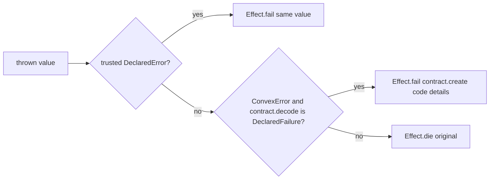

# feat: Effect foundation request scope, failure audit, error helpers and Action registry

## Goal Capsule

- Objective: Applications built on `cvx-kit/effect` get one audit record per request without hand-written flags, see failed operations with their declared error code, raise and recover declared errors without per-domain helpers, and run Convex actions through the same contract-typed, audited registry model as commands and queries.
- Means: an Effect request scope shared by nested `exec` calls (KTD1), a host-free failure-audit sink plus declared-defect projection (KTD3, KTD4), `effectErrors` `fail`/`attempt` helpers also injected into contracted registry factories (KTD5, KTD6), and a `foundation.Action` registry reusing the command lifecycle (KTD7).
- Authority: this plan's KTDs, then `skills/cvx-kit/references/conventions.md`, then existing kit patterns in `src/modules/effect/*`.
- Stop conditions: a settled decision proves infeasible; a change would need edits to the Convex component deployment graph (`src/components/foundation` server code); typing for contracted Action operations (U5) exceeds a reasonable effort, in which case U5 is deferred and the PR says so.
- Execution profile: one PR to `ImRLopezAG/cvx-kit` `main`; each unit is one commit with its tests, docs, llms and CHANGELOG entries.
- Ship: `lfg` pipeline (ce-work, review, ce-commit-push-pr).

## Product Contract

### Summary

Five improvements to the Effect foundation, driven by evidence from the one-office consumer (about 15 domain modules): automatic nested-audit scoping, failure auditing with declared codes, thrown declared errors keeping their code at the API boundary, `attempt`/`fail` error helpers, and an Action registry.

### Problem Frame

One-office composes registries inside one request (`salesCommands` binds `customersCommands.withContext({ ...ctx, nestedAudit: true })`). Every nested registry writes its own audit entry, so the app threads a `nestedAudit` flag through 25 `withContext` call sites and checks it in every `audit` callback. That adds up to about 107 lines, plus a custom oxlint rule.
Failures are invisible. The lifecycle short-circuits before `audit`, observability is payload-free and disabled there, and a mutation's writes, including any audit write, roll back when it fails.
Each domain's `errors.ts` hand-rolls `attempt = (fn) => Effect.tryPromise({ try: fn, catch: (e) => e })` and `fail(code)`, which throws `xErrors.create(code, {})`. A thrown declared error becomes a defect, and `projectErrorCause` turns it into `UnknownFailure`, so the client loses the code. One-office added a lint rule (`effect-throws`) to compensate.
128 of 171 `create(` calls pass `{}` details.
Convex actions (e-CF provider calls, background settlement, DGII signing) are ad-hoc `systemAction`/`internalAction` functions outside the registry model, with no contract typing, audit or error projection.

### Requirements

- R1. A command `exec` started while another command, query or action of the same request is executing joins the outer request scope automatically; no consumer flag or context field is needed.
- R2. In the default mode, when an enclosing operation of the request scope declares an audit callback, nested operations skip their audit callback and write no entry; the outermost auditing operation's entry stands for the request. A nested operation with no auditing ancestor audits normally, so a request never loses its only audit entry. A foundation-level option restores per-operation entries.
- R3. Audit callbacks may read the scope they entered (root operation, parent operation, depth; `undefined` for a root) so applications that keep per-operation entries can correlate them.
- R4. A failed command, query or action reports one failure-audit entry per distinct failure to an optional foundation sink: kind, operation, classification, error code, whether the code was declared, scope, plus declared details and input only through application-supplied redactors. Raw input, unredacted details, defect messages and stacks are never included. A nested failure that a parent recovers from is still reported.
- R5. A declared error that was thrown instead of failed (a defect whose value is a contract-trusted `DeclaredError`) projects to its `DeclaredFailure` at the API boundary and in failure audit, instead of `UnknownFailure`. Untrusted look-alikes still project to `UnknownFailure`.
- R6. `attempt(fn)` runs a sync or async function and returns an Effect whose failure channel holds the contract's typed `DeclaredError` when the thrown value is a trusted declared error or a `ConvexError` whose data decodes under the contract. Any other throw stays a defect.
- R7. `fail(code, details?)` returns a yieldable Effect that fails with the typed declared error; `details` may be omitted only when the code declares no detail fields.
- R8. Contracted Command and Query registries (and contracted Action registries when U5 lands) whose contract declares a full error contract expose `fail` and `attempt` on the operations factory, typed to that contract.
- R9. `foundation.Action({ context, operations })` (and a contracted form, U5, which the user allowed to defer if too large) runs contract-typed actions with context injection, guards, middleware, optional audit through a dedicated action audit writer, observability, failure audit and declared-error projection at the API boundary.
- R10. Each feature ships with tests (real Convex runtime through `convex-test` where the repo already does), a CHANGELOG entry, skill docs and an `llms.md` entry.

### Scope Boundaries

- No changes to the Promise foundation (`Foundation.Command`, deprecated) or the foundation component's server code.
- No durable persistence of failed mutations' audit entries. Convex rolls back the transaction, so the sink is host-free; see KTD3.
- No `expose()` for actions. `selectOperation` supports only `mutation` and `query`.
- No `permission` on actions. `checkPermission` is typed for the app's mutation/query host; actions use `guard`.
- No idempotency or replay (`prepare`, `replayResult`) for actions.
- No edits to `/Users/angel/dev/one-office`.
- Service registry: out of scope. Nothing in the evidence calls for it beyond what Action plus `context` injection already give.

#### Deferred to Follow-Up Work

- Rewriting one-office's domains to drop `nestedAudit`, local `attempt`/`fail`, and the `effect-throws` lint rule.
- An oxlint rule in `cvx-kit/oxlint` against throwing inside `Effect.gen`. After R5 a thrown declared error keeps its code, so the rule's main motivation is gone.
- A `create` method on `combineErrorContracts` results, so registries whose contract is a combined contract (six POS registries in one-office) also get factory `fail`/`attempt`. Until then those registries call `effectErrors(memberContract)` for the member they raise from.
- Converting one-office's `runOperation` Promise bridges (`Effect.runPromiseExit` inside handlers) to yielded nested `exec` calls, so they join the request scope (KTD1).

### Success Criteria

- A nested-registry mutation test on `convex-test` writes exactly one audit row by default, and one row per operation with `nestedAudit: 'separate'`.
- A failing mutation emits one failure-audit entry carrying the declared code and details, and its database writes are rolled back.
- `fail('NOT_FOUND')` compiles for a `details: {}` code and fails to compile for a code with required details.
- An Action runs on `convex-test`, calls `ctx.runMutation` with a typed ref, audits through `writeActionAudit`, and projects declared failures as `ConvexError` at an `effectApiBuilder` action boundary.
- `bun run typecheck`, `bun run lint`, `bun run test`, `bun run skills:check` and `bun run test:package:effect` all pass.

### Sources

- Kit: `src/modules/effect/{command,query,operation,domain,errors,normalize,api-runtime,foundation}.ts`, `src/components/foundation/modules/command/lifecycle.ts`, `src/components/foundation/modules/observability/observability.ts`, `src/modules/contracts/{errors,domain,binding,exposure}.ts`.
- Consumer evidence: `/Users/angel/dev/one-office/apps/convex` — `src/domain/sales/commands.ts:18-21`, `src/domain/sales/customers/commands.ts:26-32`, `src/domain/sales/errors.ts`, `tools/oxlint/convex/effect-throws.ts`, `tools/oxlint/convex/enforcement.ts`, `src/domain/ecf/internal.ts`, `src/components/ecf/*Processing.ts`, `src/foundation.ts`, `src/audit.ts`.

## Planning Contract

### Key Technical Decisions

- KTD1. The request scope is an Effect `Context.Reference` with an `undefined` default, defined in a new `src/modules/effect/scope.ts` (`effect` 4.0.2 `Context.Reference(key, { defaultValue })`). Each `exec` (command, query, action) reads it. If it is unset, the operation is the root. The `exec` then provides `{ root, parent: operation, depth: depth + 1, audited, reported }` around its lifecycle, so nested `exec` calls yielded inside handlers or middleware inherit it. `audited` is true once any enclosing operation declares an audit callback. `reported` is a per-scope `WeakSet` of failure values already reported (KTD3). A Reference adds no requirement to the `R` channel and is scoped to the Effect program, so sequential top-level `exec` calls in one handler each stay roots. An `exec` run through a Promise bridge (`Effect.runPromise*` inside a handler) starts a new program and is a new root. The docs tell applications to yield nested `exec` calls instead. (session-settled: user-directed — chosen over keeping the `nestedAudit: true` ctx-spread convention: 103 hand-rolled copies in one-office.) The observability module (`Observability.start`) has no span or parent model to reuse. It is a payload-free per-operation emitter, so the scope is new and observability stays unchanged.
- KTD2. Default nested-audit mode is `'fold'`: a nested operation whose scope has `audited: true` skips its audit callback and the audit write, and the auditing ancestor's entry stands for the request. A nested operation with no auditing ancestor (for example, under a query root or an action without audit) audits normally, so fold never removes a request's only entry. An ancestor that declares audit but returns `null` at runtime has deliberately chosen not to audit the request. `createEffectFoundation({ nestedAudit: 'separate' })` restores per-operation entries. Audit callbacks receive, as a third argument, the scope they entered (`undefined` for a root) (R3). This changes behavior for consumers that relied on nested entries, so CHANGELOG lists it under **Changed** as breaking. Per the 0.x rules the release that carries it is a minor. Skipping the callback, and not just the write, keeps nested callbacks that assume a top-level context from running. Conflict call-out: the user also allowed "child entries". `'separate'` with the scope argument covers that without a stored-shape change.
- KTD3. Failure audit is a host-free foundation option `auditFailure: { emit(entry), errors?, details?(details, code, operation), input?(input, operation) }`.
  - Convex rolls back a failed mutation's writes, including an in-transaction audit write and scheduled functions, so a host-bound in-transaction writer would silently persist nothing. A host-free sink is the only honest default.
  - Inside queries and mutations, `emit` runs in the Convex runtime without `fetch`. It should log synchronously, and external telemetry is reached through Convex log streams. Only action failures may call external endpoints directly. The docs say so.
  - The sink runs in `Effect.onExit` for Fail and Die causes, not for pure interruption. Errors and rejections from the sink are swallowed so the original failure is preserved, matching `Observability`'s inertness.
  - Reporting happens at the innermost failing operation. That operation projects with its own registry's contract, so codes from other domains survive, and it still reports when a parent later recovers. Each enclosing operation skips a failure value already in the scope's `reported` set (identity). Each distinct failure is therefore reported once in either mode, and a different failure raised by a parent is reported again.
  - Entry fields follow R4. `details` and `input` exist only when their redactor returns a plain JSON record. Contract-valid details can still carry personal data, so they are opt-in like input. A redactor that throws or returns anything else omits the field. (session-settled: user-directed — chosen over auditing raw input: no secret leakage.)
- KTD4. `projectErrorCause` additionally projects a cause whose single reason is a Die carrying a value the contract trusts (`contract.project(defect)` returns `DeclaredFailure`). Trust is identity-based (the contract's private WeakMap), so spoofed objects still project to `UnknownFailure`. Fail-reason behavior is unchanged. Failure audit (KTD3) projects with the registry's `contract.errors` and falls back to `auditFailure.errors`. That fallback can be the app's combined API contract (a `combineErrorContracts` result), and it also covers inline registries. Only when both yield `UnknownFailure` does the entry carry `errorCode: 'UNKNOWN_FAILURE'`, `declared: false`.
- KTD5. `effectErrors(contract)` in `cvx-kit/effect` returns `{ fail, attempt }` bound to a full `ErrorContract`. `cvx-kit/errors` stays Effect-free because its module-load cost is guarded and it has 56 consumer imports.
  - `fail(code, ...details)` is `Effect.fail(contract.create(code, details ?? {}))`. A rest tuple makes `details` optional exactly when the code's detail map has no keys.
  - `attempt(fn)` uses `Effect.tryPromise({ try: async () => fn(), catch })` so sync returns and sync throws take the promise path (Effect 4's `tryPromise` calls `.then` on the result). `catch` returns a sentinel for unrecognized values, then the Effect dies with the original value. Recognition order: a trusted `DeclaredError` is failed with as is. A `ConvexError` whose data `contract.decode` accepts is rebuilt through `contract.create(code, details)` so it gets a trusted identity. (session-settled: user-directed — chosen over mapping every throw to a typed error: preserve defect semantics.)
  - `Effect.catchTag('DeclaredError', …)` works because every declared error shares that tag. Per-code handling uses `Effect.catchIf`. The plan adds no per-code tag API.
- KTD6. The handler context is user-owned and may be a primitive (tests bind numbers), so `fail`/`attempt` cannot be merged into it. "Injected" means the operations factory: `operations: ({ command, fail, attempt }) => …`. They are present (typed) only when the contract's `errors` has `create` and `decode`, detected at runtime by those two functions. They are absent for inline registries and `combineErrorContracts` results, which have no `create`.
- KTD7. `foundation.Action` reuses `executeCommandLifecycle` through a new `src/modules/effect/action.ts`. That gives the same order (context, middleware, default guard, guard, handler, result decode, audit, write). There is no `prepare` and no `permission`.
  - `classification` is optional and defaults to `'action'`. `audit` is optional per operation and per registry.
  - Entries go to a new foundation option `writeActionAudit(host, entry)` whose host is the action ctx. If any operation or the registry declares `audit` and the writer is missing, registration fails at first bind, never after side effects.
  - The registry's host type check (`HostCompatible`) uses only `writeActionAudit`.
  - Actions are not transactional, so a successful handler's side effects (provider submissions, settlement) have already happened when the audit write runs. A `writeActionAudit` failure after a successful handler therefore does not fail the action. It is reported to `auditFailure.emit` with `errorCode: 'ACTION_AUDIT_WRITE_FAILED'`, and the decoded result is returned, so callers do not retry completed work. (session-settled: user-directed — chosen over leaving actions as ad-hoc internalAction: consistency with the registry model.)
- KTD8. Contracted actions use a new `actions` section on `DomainContract`, bound through `snapshotOperations(…, 'actions', audit)` and a `'action'` kind in `domainEffectFactory`. This is U5 and may be deferred (Goal Capsule stop condition) without blocking U4.

### High-Level Technical Design

Request scope across nested execs (KTD1, KTD2):

```mermaid
sequenceDiagram
  participant API as effect API handler
  participant S as sales.exec (root)
  participant C as customers.exec (nested)
  participant W as writeAudit
  API->>S: exec('createInvoice') — scope unset → root
  S->>S: provide scope {root:'createInvoice', depth:1}
  S->>C: handler yields customers.exec('ensure')
  C->>C: reads scope depth=1 → nested
  C-->>S: result (fold: audit callback + write skipped)
  S->>W: root audit entry (callback receives scope)
  Note over S,C: on failure, the innermost failing op emits; ancestors skip the same failure value
```

Mode × position matrix:

| Mode | Root op | Nested op |
|---|---|---|
| `fold` (default) | audit callback + write | with an auditing ancestor: no audit callback, no write; without one: audit callback + write |
| `separate` | audit callback + write | audit callback + write |

In both modes, failure emit happens at the innermost failing operation, once per distinct failure value (scope `reported` set).

Error flow for `attempt` (KTD5):



### Assumptions

- Pipeline mode: the scoping confirmation was skipped. Inferred bets: fold as the default (KTD2), a host-free failure sink (KTD3), factory injection as the meaning of "ctx injection" (KTD6), Action without `permission`/`expose` (KTD7).
- `Context.Reference` values provided with `Effect.provideService` are visible to Effects yielded inside handler callbacks normalized by `normalizeEffect`. This holds because normalization stays inside the same fiber; U1's tests prove it.
- `convex-test` supports `t.action` with `ctx.runMutation` against fixture modules (`test/fixture/**`).

### Sequencing

U1 → U2 → U3 → U4 → U5 → U6. U2 depends on U1 for scope-aware suppression. U3 is independent of U1/U2 except for the shared docs. U4 uses U1–U3. U5 extends U4. U6 is the docs/CHANGELOG roll-up and gate run.

## Implementation Units

### U1. Request scope and nested-audit folding

**Goal:** Nested `exec` calls join the root's scope automatically. Nested audit folds by default, and the scope reaches audit callbacks.

**Requirements:** R1, R2, R3, R10; KTD1, KTD2.

**Dependencies:** none.

**Files:**
- Create `src/modules/effect/scope.ts` (Reference, `RequestScope` type, helpers to read and enter).
- Modify `src/modules/effect/command.ts`: read the scope in `exec`, wrap the lifecycle, skip the audit callback when nested in fold mode, pass the scope as the audit's third argument, and add `nestedAudit?: 'fold' | 'separate'` to `EffectCommandDependencies`.
- Modify `src/modules/effect/query.ts`: read and enter the scope.
- Modify `src/modules/effect/operation.ts` and `src/modules/effect/domain.ts`: audit callback types get an optional third `scope` parameter.
- Modify `src/modules/contracts/binding.ts`: the registry-level audit wrapper forwards the third argument.
- Modify `src/modules/effect/foundation.ts`: pass the option through.
- Tests: `test/effect-request-scope.test.ts` (new) and `test/effect-command-types.ts`.

**Approach:**
1. `scope.ts` exports `RequestScope = { root: string; parent?: string; depth: number }`, the `Context.Reference`, and `enterScope(operation, effect)`, which reads the current value and provides the child value.
2. `command.ts` computes `nested = current !== undefined` before running the lifecycle. In fold mode, nested `audit` returns `Effect.succeed(null)` without invoking the definition.
3. The Promise lifecycle in `lifecycle.ts` is untouched; the Effect adapter owns the change.

**Patterns to follow:** `normalizeEffect` usage in `command.ts`; the `effectLifecycle` algebra.

**Test scenarios:**
- On `convex-test`, an outer command whose handler yields an inner registry's `exec`, with both audits returning entries, writes one audit row (outer) by default.
- The same with `nestedAudit: 'separate'` writes two rows. The inner callback's third argument has `{ root: 'outer', parent: 'outer', depth: 1 }`, and the outer callback's third argument is `undefined`.
- The inner audit callback is not invoked in fold mode (counter stays 0).
- Fold mode with a root that declares no audit (a query root, since commands always declare one): a nested command executed inside it still writes its row. U4 adds the same check for an action root without audit.
- A nested `exec` run through `Effect.runPromise` inside a handler is its own root (pins KTD1's Promise-bridge behavior).
- Two sequential top-level `exec` calls in one mutation handler each write their own row (each is a root).
- One Effect value yielded twice at top level stays root both times, matching the existing reuse test.
- A nested query inside a command sees depth 1. A query at top level is root.
- Existing `test/effect-context.test.ts` and `test/effect-command.test.ts` still pass unchanged.
- Type test: a registry-level audit declared with three parameters type-checks, and the scope parameter is optional.

**Verification:** the new and existing effect tests pass; typecheck passes.

### U2. Declared-defect projection and failure audit

**Goal:** Thrown declared errors keep their code, and failures reach an optional, redacted audit sink.

**Requirements:** R4, R5, R10; KTD3, KTD4.

**Dependencies:** U1.

**Files:**
- Modify `src/modules/effect/errors.ts` (Die path).
- Create `src/modules/effect/failure-audit.ts` (entry type, `reportFailure(exit, meta)` helper).
- Modify `src/modules/effect/command.ts`, `src/modules/effect/query.ts` and `src/modules/effect/foundation.ts`: add the `auditFailure` option, call it in `onExit`, and pass `contract.errors` from the binding overloads into `createEffect*`.
- Tests: `test/effect-failure-audit.test.ts` (new), plus additions to `test/effect-api.test.ts` and `test/domain-boundaries.test.ts`.

**Approach:**
1. `projectErrorCause`: keep the single-reason check. For a Die reason, return `contract.project(reason.defect)` when it is a `DeclaredFailure`, else `UnknownFailure`.
2. `reportFailure` builds the entry from the projected failure (registry contract, then `auditFailure.errors`). It skips interrupt-only causes and skips a failure value already in the scope's `reported` set, adding object failure values to it. It calls the `details` and `input` redactors only if provided and keeps a result only when it is a plain JSON record. It runs `emit` with errors swallowed.
3. The binding overloads already receive `configuration.contract`; thread `contract?.errors` into `createEffectCommand`/`createEffectQuery` configuration.

**Patterns to follow:** `Observability.start().failed` inertness; the `observationFailure` helper.

**Test scenarios:**
- On `convex-test`, a command that writes a row then yields `Effect.fail(errors.create('NOT_FOUND', {}))` emits one entry `{ kind: 'command', operation, classification, errorCode: 'NOT_FOUND', declared: true }` without `details`, and the row is rolled back.
- With a `details` redactor, a declared error whose details contain `{ email, id }` emits only what the redactor returns. Without one, the entry has no `details`.
- A nested registry under a different error contract fails with its declared code. The single entry carries that code (innermost reports; the root skips the same value).
- A parent that catches a nested declared failure and succeeds still produces one entry for the nested failure.
- An inline registry (no contract) with `auditFailure.errors` set to a combined contract reports the declared code.
- A handler that throws `errors.create('NOT_FOUND', {})` inside `Effect.gen` emits `errorCode: 'NOT_FOUND'`, and the API boundary (`effectApiBuilder` with `errors`) rejects with `ConvexError` data `DeclaredFailure` `NOT_FOUND`.
- A thrown plain `Error('secret token xyz')` emits `errorCode: 'UNKNOWN_FAILURE'`, `declared: false`. The entry contains no message, stack or input. The API boundary still yields `UnknownFailure`.
- A spoofed `{ _tag: 'DeclaredError', code: 'NOT_FOUND', details: {} }` thrown or failed projects to `UnknownFailure`.
- With an `input` redactor returning `{ id }`, the entry carries only `{ id }`. A redactor that throws or returns a non-record yields no `input` field, and the failure still propagates unchanged.
- An `emit` that throws or rejects does not change the original failure (same error instance rejected).
- A nested failure propagating through the root emits exactly one entry (operation = the nested operation, `scope.root` = root) in both modes.
- A query failure emits `kind: 'query'`.
- An existing `domain-boundaries` test: a foreign contract's error still projects to `UnknownFailure`.

**Verification:** new tests pass; the existing effect-api and domain-boundaries suites pass.

### U3. `effectErrors` fail/attempt and factory injection

**Goal:** Kit-provided `fail`/`attempt` replace per-domain helpers. Contracted registries get them on the factory.

**Requirements:** R6, R7, R8, R10; KTD5, KTD6.

**Dependencies:** none (U1/U2 only for shared docs).

**Files:**
- Create `src/modules/effect/failures.ts` (`effectErrors`).
- Modify `src/modules/effect/domain.ts` (`DomainEffectFactory` gains `fail`/`attempt` when the contract's errors are full), `src/modules/effect/command.ts` and `src/modules/effect/query.ts` (pass contract errors into `domainEffectFactory`), and `src/modules/effect/client.ts` plus `src/effect.ts` (export).
- Tests: `test/effect-errors.test.ts` (new) and `test/effect-errors-types.ts` (new type tests).

**Approach:**
1. `failures.ts`: `fail` uses a rest tuple `[keyof Details] extends [never] ? [details?: Details] : [details: Details]`.
2. `attempt<A>(fn: () => A | PromiseLike<A>): Effect<A, DeclaredError<Definitions>>` follows KTD5's recognition order and uses `decodeFailure` from `contracts/errors.ts` for `ConvexError`.
3. `domainEffectFactory(entries, kind, errors?)` spreads `effectErrors(errors)` into the returned factory object when `errors.create` and `errors.decode` are functions.
4. Type plumbing: thread the `Contract['errors']` type into `DomainEffectFactory` as a new trailing generic, defaulting to `never`, so the factory adds `{ fail; attempt }` only when it extends `ErrorContract<infer D>`.

**Patterns to follow:** `contracts/errors.ts` `create`/`decode` trust rules; existing type tests such as `test/error-contract-helper-types.ts`.

**Test scenarios:**
- `yield* fail('NOT_FOUND')` inside a command handler on `convex-test` fails with a trusted error that `errors.project` maps to `NOT_FOUND`.
- `fail('LIMIT', { max: 3 })` validates details. `fail('LIMIT', { max: 'x' })` dies with `Invalid declared error details`, the contract's existing behavior.
- `attempt(async () => { throw errors.create('NOT_FOUND', {}) })` then `Effect.catchTag('DeclaredError', …)` recovers with `code === 'NOT_FOUND'`.
- `attempt` over a function throwing `errors.toConvexError('NOT_FOUND', {})` fails with a trusted `DeclaredError` (`errors.project` is declared).
- `attempt` over `throw new Error('boom')` dies (Exit cause is Die, defect is the same Error).
- `attempt` over a `ConvexError` with an undeclared code or a foreign shape dies.
- `attempt(() => 5)` (sync) succeeds with 5.
- Factory: `Command({ contract: { errors, commands }, operations: ({ command, fail, attempt }) => … })` exposes both. A contract without `errors` does not have them (type error on destructuring use; runtime `undefined`).
- Types: `fail('NOT_FOUND')` compiles. `fail('LIMIT')` without details errors (`@ts-expect-error`). An unknown code errors. `attempt`'s error type is the contract's `DeclaredError` union.

**Verification:** new runtime and type tests pass; the packed-effect smoke still imports.

### U4. Action registry (inline operations)

**Goal:** `foundation.Action({ context, operations, audit?, defaults? })` runs actions through the shared lifecycle.

**Requirements:** R9, R10; KTD7, KTD1–KTD4 applied to actions.

**Dependencies:** U1, U2, U3.

**Files:**
- Create `src/modules/effect/action.ts` (`createEffectAction`, `bindEffectAction`, `ActionAuditWriterError`).
- Modify `src/modules/effect/operation.ts` (`action` helper on `effectOperationFactory`: optional classification, no `prepare`/`replayResult`/`permission`, optional `audit`), `src/modules/effect/foundation.ts` (add `Action`; `writeActionAudit?` option), and `src/modules/effect/client.ts` plus `src/effect.ts` (types).
- Tests: `test/effect-action.test.ts` (new), `test/effect-action-types.ts` (new), and a fixture under `test/fixture/` for an internal mutation the action calls.

**Approach:**
1. Mirror `createEffectCommand`, but `prepare` returns `undefined`, `permission` is never set, `audit` defaults to `() => null`, and `writeAudit` maps to `writeActionAudit`.
2. Observability classification defaults to `'action'`.
3. Use the shared `enterScope` and `reportFailure` (`kind: 'action'`).
4. `withContext` and `exec` match commands; no `expose`.
5. Snapshot validation: any operation `audit` (or a registry `audit`) present without `writeActionAudit` throws `ActionAuditWriterError` on first operation bind.

**Patterns to follow:** `createEffectCommand` and `bindEffectCommand` overload structure; the `effect-command.test.ts` harness on `convex-test`.

**Test scenarios:**
- On `convex-test`, `t.action` runs `actions.exec('settle', input, ctx)`. The handler calls `ctx.runMutation(internal fixture ref, args)`, the row exists, and the decoded result is returned.
- Input that fails the contract schema fails before the context resolver runs.
- A guard failure skips the handler.
- Middleware `next({ context })` enriches the handler context.
- Audit returns an entry and `writeActionAudit` receives it with `classification` (default `'action'` when omitted).
- An operation declaring `audit` on a foundation without `writeActionAudit` throws `ActionAuditWriterError` before the handler runs.
- `writeActionAudit` throws after a successful handler: the action still resolves with its result, and `auditFailure.emit` receives `errorCode: 'ACTION_AUDIT_WRITE_FAILED'`.
- A handler failing with a declared error, wrapped in `effectApiBuilder(actionGeneric, { errors })`, rejects with `ConvexError` `DeclaredFailure` and `auditFailure.emit` receives `kind: 'action'`.
- `attempt(() => ctx.runMutation(ref, …))`, where the mutation throws `errors.toConvexError('NOT_FOUND', {})`, surfaces a catchable typed `DeclaredError` in the action.
- An action handler that yields another Action registry's `exec` joins the scope (fold: one audit write).
- Types: `classification` optional; `prepare`, `permission` and `replayResult` rejected (`@ts-expect-error`); `exec` input/result typed from schemas.

**Verification:** new tests pass; existing command/query suites unchanged.

### U5. Contracted actions (`actions` section)

**Goal:** Actions can be declared in `defineDomainContract({ errors, actions })` and implemented with `action.<key>(…)` and `action.handler(…)`.

**Requirements:** R8, R9, R10; KTD8.

**Dependencies:** U4.

**Files:**
- Modify `src/modules/contracts/domain.ts` (`DomainActionContract`; `actions` section; `'actions'` in `CheckedDomain`'s section keys and in `memoizeAccessors`'s section list, or getter-declared actions fail binding), `src/modules/contracts/binding.ts` (`'actions'` section; optional registry audit wrapping), `src/modules/effect/domain.ts` (kind `'action'`), and `src/modules/effect/action.ts` (contracted overload).
- Tests: additions to `test/effect-action.test.ts`, `test/effect-action-types.ts` and `test/domain-contracts.test.ts`.

**Approach:**
1. Generalize `domainEffectFactory`'s `Command extends boolean` to a three-way kind while keeping existing call sites' types.
2. Lazy getter-declared operations follow the existing `isLazyOperation` path.

**Patterns to follow:** `bindEffectCommand` contracted overloads; `snapshotOperations` command branch.

**Test scenarios:**
- A contracted action registry executes with exact-key enforcement. An extra key or a missing key throws `Contract operation keys must match exactly`.
- A registry-level `audit` receives `{ operation, input, result }` for actions.
- A getter-declared action operation binds on first exec.
- `fail`/`attempt` are present on the action factory when the contract declares errors.
- A contract with an `actions` entry containing `handler` is rejected by `CheckedDomain` (type) and at runtime (`bindDomainImplementation`).

**Verification:** tests pass. If typing proves intractable, revert U5 and record the deferral in the PR.

### U6. Docs, llms, CHANGELOG and gate run

**Goal:** Each feature is documented and the full gates pass.

**Requirements:** R10.

**Dependencies:** U1–U5.

**Files:**
- Modify `CHANGELOG.md` (`[Unreleased]`: Added and Changed, with the breaking note for KTD2 and the projection change for KTD4).
- Modify `skills/cvx-kit/references/effect.md` (request scope, failure audit, Actions sections), `skills/cvx-kit/references/commands.md` (nested audit, `fail`/`attempt`), `skills/cvx-kit/references/command-context.md` (nested calls paragraph now describes folding), `skills/cvx-kit/references/domain-contracts.md` (`actions` section, factory `fail`/`attempt`), `skills/cvx-kit/references/client-failures.md` (thrown declared errors keep their code), and `skills/cvx-kit/references/llms.md` (exports map and rules).
- Modify `skills/cvx-kit/references/conventions.md` if `actions.ts` guidance changes (actions may use `foundation.Action`).

**Approach:** Units add their own doc paragraphs as they land. U6 reconciles wording, runs `bun run skills:check`, and runs the full gate set. Document contracted actions only if U5 landed. The breaking CHANGELOG entry and `command-context.md` state plainly that nested operations under an auditing ancestor no longer write audit rows by default, and name `nestedAudit: 'separate'` as the setting that keeps them. The failure-audit docs state the no-`fetch` runtime limit (KTD3).

**Test scenarios:** Test expectation: none -- documentation and gate run; `skills:check` and `test/changelog.test.mjs` validate structure.

**Verification:** every command in the Verification Contract passes.

## Verification Contract

- `bun install --frozen-lockfile` (the worktree has no `node_modules`).
- `bun run typecheck`
- `bun run lint`
- `bun run test`
- `bun run skills:check`
- `bun run test:package:effect` (build plus packed Effect import, exercises the new exports)
- `bun run bench:app-load` only if U1–U4 add imports to non-effect entry points; they should not.

## Definition of Done

- U1–U4 and U6 landed, each as its own commit with tests, docs, llms and CHANGELOG lines. U5 landed, or its deferral is recorded in the PR body.
- All Verification Contract commands pass locally.
- No raw input, defect message or stack reaches a failure-audit entry (U2 tests prove it).
- No edits under `/Users/angel/dev/one-office` or the main checkout `/Users/angel/dev/cvx`.
- No abandoned-attempt or experimental code remains in the diff.

## Deferred / Open Questions

- Fold as the default nested-audit mode (KTD2) changes behavior for existing consumers that nest registries. The plan keeps it as the default because the user's request said nested calls should join automatically with no consumer flag, and the audited-ancestor rule prevents a request from losing its only entry. If the user prefers opt-in, flip the default to `'separate'` before merge and drop the breaking note. Record this in the PR body.
