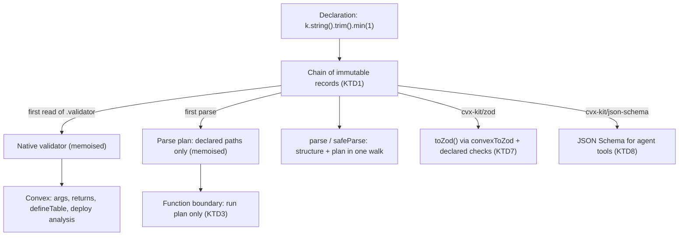
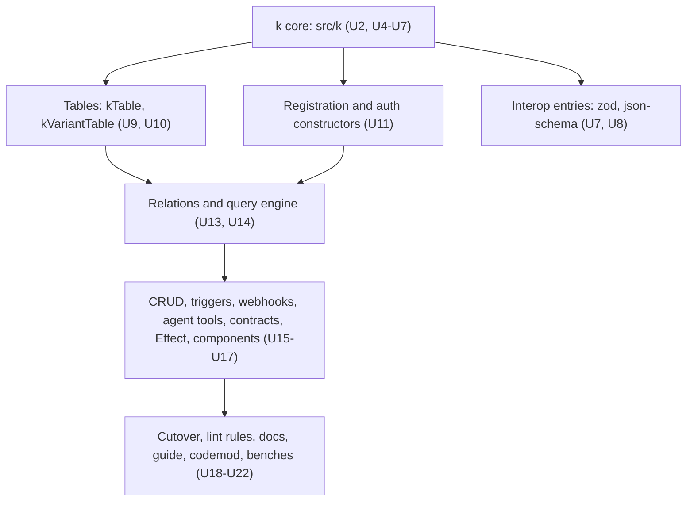

# cvx-kit 2 Native Validators - Plan

## Goal Capsule

- **Objective:** A Convex function in an app built on cvx-kit spends a small fraction of today's time and memory loading its module before the handler runs, so calls stop approaching Convex's 1 s limit.
- **Means:** cvx-kit 2 removes Zod from the core and replaces it with `k`, a chainable validator layer built on native Convex validators (KTD1, KTD2).
- **Product authority:** the kit owner (Angel Lopez). This plan covers the kit only: the proof spike, the v2 kit, the migration guide and the codemod. Migrating Accord and one-office is separate work.
- **Execution profile:** one pull request. Units run in dependency order and each is committed with its tests green; v2 is built beside v1 until the cutover unit (KTD9).
- **Stop conditions:** the spike gate in U3 fails (Success Criteria); or a v2 table cannot match v1's stored shape (R15).
- **Finishes the work:** the executor implements, verifies and opens the pull request; the owner merges and publishes.
- **Standing limits:** no publish to npm; no merge; Accord and one-office are read-only; the `perf/module-load-validation-deps` worktree is not edited; no `"use node"` in Convex code; `.env` files are never read, printed or committed.

---

## Product Contract

### Summary

cvx-kit 2 is a clean breaking release with no Zod in the core.
Schemas are written with `k`: Convex receives a plain native validator and validates structure itself, and the kit runs checks, defaults, date handling, refinements and transforms only where a schema declares them.
Tables keep today's declaration style under `kTable`, the rest of the kit moves onto the native engine, and Zod survives only as an optional conversion in a separate entry.

### Problem Frame

Convex does not reuse isolates between calls, so every query and mutation re-evaluates its whole static import graph.
Schema construction at import is therefore paid on every call.
Accord evaluates one API module in 175–250 ms and 24–40 MB locally, roughly four times that when deployed, while its handlers run in 0.2–47 ms, and some calls have hit the 1 s query limit.

Most of that load is Zod and the kit code that exists to drive Zod.
In a CPU profile of Accord `api/payments`, Zod self time is about 75 ms, work under cvx-kit frames about 105 ms, bundle parse about 75 ms and GC about 38 ms; Zod is 741 KB of that bundle and cvx-kit 211 KB.
Parse speed is not the cost: validating args and a 100-row result takes about 0.1 ms warm.

The 0.1.x performance pass took what it could while staying on Zod (getter-declared args and returns cut the synthetic per-request fixture from 43.14 ms to 20.58 ms).
A drop-in on `zod/mini` reached only a 33% construction gain, cost 2.45× the TypeScript instantiations, and could not remove classic Zod from bundles because the kit and `convex-helpers/server/zod4` both import it.

The kit also carries a maintenance cost from mirroring Zod internals: a fast path gated on an exact list of audited Zod versions, 99 constructor registrations, a patched `_zod.parse`, and source-text matching of Zod getters.
That fast path was silently off for Zod 4.6.7 until it was audited.

### Key Decisions

- **No Zod in the core; validators are built on native Convex validators.** (session-settled: user-directed — chosen over staying on Zod through a `zod/mini` drop-in: the prototype gained 33%, cost 2.45× TypeScript instantiations and left classic Zod in bundles.) Governs R1, R2, R26.
- **`k` keeps the full convenience set, including refinements and transforms.** (session-settled: user-directed — chosen over a minimal layer of structure, declarative checks and defaults only: the owner wants these as helpers on top of native values, not pushed into handlers.) Governs R4, R9.
- **Clean break with a migration guide; no Zod front door and no side-by-side engines.** (session-settled: user-directed — chosen over a temporary Zod compatibility entry on the v2 engine and over two kits installed together: this is a deliberate breaking change.) Governs R27, R28, R30.
- **The namespace is `k`, with `kTable` and `kVariantTable`.** (session-settled: user-approved — chosen over `cv` and over an unprefixed `v` that shadows Convex's: `k` stays distinct in files that also use native `v`.) Governs R23.
- **Tables keep today's declaration style and derived boundaries.** (session-settled: user-directed — chosen over redesigning the table surface: the field lists that derive command, public and server shapes are what make tables productive.) Governs R13, R14.
- **Table fields are a plain object and ids are `k.id('table')`.** (session-settled: user-directed — chosen over keeping the `(id) => ({...})` callback: v1 calls the callback immediately only to pass the helper's `zid`, which a native id makes unnecessary.) Governs R13.
- **Zod is reachable only as a conversion through convex-helpers, in a separate entry.** (session-settled: user-directed — chosen over keeping any Zod-typed surface in the core: Zod must not enter a Convex bundle unless the app imports that entry.) Governs R24, R25, R26.
- **Dates are built into `k` with no dependency.** (session-settled: user-approved — chosen over date-fns in the core: a dependency would put weight back into every function bundle.) Governs R10.
- **Transforms and defaults run only on input-position shapes.** Storage and return shapes then have identical input and output types, which keeps both runtime work and type cost low. Governs R9.
- **Validation failures get a kit-owned wire shape.** The `ZodError` payload cannot survive without Zod. Governs R21.
- **The release is `cvx-kit@2.0.0` under the same package name.** The owner calls this version 2; the roadmap's 1.0 milestone is skipped. Governs R30.
- **A codemod supports the migration guide.** The guide is the committed deliverable; the codemod covers only the mechanical majority. Governs R27, R28.
- **Nothing is built before a measured spike passes.** The payoff is unknown, and the `zod/mini` attempt showed a plausible design can fail on type cost. Governs R29.

### Actors

- A1. Kit owner: decides scope, approves the spike result, publishes.
- A2. App developer on Accord or one-office: declares tables, functions and contracts with the kit, and later migrates them.
- A3. Convex runtime: validates args, returns and documents from the native validators the kit hands it.
- A4. Client code: sends args and reads validation failures.

### Requirements

**Validator layer (`k`)**

- R1. Every `k` schema carries a plain native Convex validator, and that validator is what Convex receives for function args, function returns and table definitions.
- R2. No core entry imports Zod or `convex-helpers/server/zod4`, and Zod is not a required peer dependency.
- R3. `k` provides factories for the structural shapes the apps use: string, number, int, int64, boolean, null, literal, enum, id, array, object, record, union, discriminated union, optional, nullable, any, JSON and bytes.
- R4. `k` provides chainable conveniences: `min`, `max`, `length`, `regex`, `int`, `trim`, case normalisation, `default`, `refine`, cross-field refinement on objects, `transform` and `pipe`.
- R5. Declaring a schema allocates nothing per chained call beyond what the declaration needs, and derived shapes are built on first use, not at import.
- R6. Object schemas support `pick`, `omit`, `extend`, `partial` and field reuse through `.shape`, and each keeps the checks, defaults and transforms declared on the fields it retains.
- R7. Every schema offers `parse` and `safeParse`; failures are structured issues with a path, a code and a message, and a schema may supply its own message.
- R8. Types are available as `k.infer`, `k.input` and `k.output`, and input differs from output only for a schema that declares a default or a transform.
- R9. Transforms and normalisers run only when the kit parses an input-position shape (function args, command input, insert and update shapes); any `transform` or `pipe` is rejected at definition on a table field or a return shape, while type-preserving normalisers such as `trim` are allowed there.
- R10. `k` validates ISO dates, ISO date-times and millisecond timestamps and converts between ISO strings and timestamps on inputs, with no date dependency.
- R11. A `k` schema can carry a description and can produce JSON Schema for agent tool inputs, from an entry that core function bundles do not load.
- R12. `k` schemas conform to Standard Schema v1, so the contract layer and form libraries can consume them directly.

**Tables**

- R13. `kTable(name, fields, options)` takes a plain object of `k` fields and the `serverFields`, `commandFields` and `publicFields` lists; `createTable`, `tenantTable` and `kVariantTable` follow the same form, with timestamps and the tenant field built in.
- R14. A table returns the boundaries v1 returns (`table`, `storage`, `schema`, `insertSchema`, `updateSchema`, `commandInput`, `publicDto`, `dto`, `toPublicDto`, `paginationOpts`, `insert`, `update`, `tools`, `tableName`), each schema-valued one as a `k` schema.
- R15. A v2 table produces the same stored shape and indexes as the v1 table it replaces, so migrating an app requires no data migration.
- R16. `toPublicDto` projects a row and re-checks it against the public shape at runtime, so a field outside `publicFields` cannot reach a client.
- R17. A default on a table field makes that field optional in insert and command inputs and is applied before the write; the stored shape marks the field optional, as v1 does, and `toPublicDto` fills the default when it projects a row that lacks the field, so public and return shapes keep the field required.

**Functions and the rest of the kit**

- R18. Function constructors (auth, Effect API builder, custom builders) accept `k` schemas or native validators for args and returns, and run a schema's declared checks, defaults and transforms on args before the handler.
- R19. A function whose schemas declare no checks, defaults or transforms adds no per-call validation work on top of Convex's own.
- R20. Relations, the query engine, compact filters, cursors, pagination, CRUD commands, contracts and declared errors, the Effect foundation, auth, triggers, webhooks, agent tools and the approvals and foundation components keep their v1 behaviour on `k` and native validators, except where this contract states a change.
- R21. Validation failures the kit raises (declared checks on args, filter boundaries, direct `parse`) reach clients in one documented, kit-owned shape; structural arg failures raised by Convex itself keep Convex's error.
- R22. The kit does no whole-registry work at import: table, relation and filter work happens per table on first use.
- R23. No public name or entry point keeps a `z` or `zod` name, except the opt-in interop entry `cvx-kit/zod` and its `toZod()` export (R24); the lint rules, skills and docs describe the v2 surface.

**Zod interop**

- R24. A separate entry converts a `k` schema or table boundary to a Zod schema through convex-helpers, exposed as `toZod()`.
- R25. The converted schema matches the structure and id typing of the source and carries the declarative checks that have a direct Zod equivalent; custom refinements and transforms are not carried.
- R26. A Convex function bundle contains no Zod code unless the app imports the interop entry.

**Migration and release**

- R27. A migration guide maps every v1 public name and entry to its v2 form, states each behaviour change, and gives an order for migrating an app by import graph.
- R28. A codemod rewrites the mechanical majority of v1 call sites and reports every site it left for manual work, by file and line.
- R29. Before v2 work beyond the validator prototype, a spike ports the schemas of Accord's finance contracts to a prototype `k` and measures them against classic Zod, `zod/mini` and plain `v.*`; if a stop condition in Success Criteria holds, the prototype is discarded and work returns to the owner.
- R30. v2 is released as `cvx-kit@2.0.0`, and v1 keeps receiving fixes on 0.1.x until both apps have migrated.

### Key Flows

- F1. A call reaches a kit function
  - **Trigger:** A4 calls a query or mutation declared with `k` args.
  - **Actors:** A3, A4
  - **Steps:** Convex validates the args against the native validator. The kit then runs the declared checks, defaults and transforms, if any. The handler receives the output type. Convex validates the return value against the native returns validator.
  - **Outcome:** Structural failures come from Convex; declared-check failures come from the kit in the R21 shape.
  - **Covered by:** R1, R18, R19, R21
- F2. A developer declares a table
  - **Trigger:** A2 writes `kTable('documents', { ... }, { serverFields, commandFields, publicFields })`.
  - **Actors:** A2
  - **Steps:** The kit records the fields. The native table definition and the insert, update, command, public and tool shapes are each built when first read.
  - **Outcome:** One declaration yields every boundary, and a function module that imports a table pays only for the boundaries it reads.
  - **Covered by:** R5, R13, R14, R22

### Acceptance Examples

- AE1. **Covers R9, R17.** Given a table field `reviewState: k.enum(['draft', 'published']).default('draft')`, when a command input omits `reviewState`, then the stored row has `reviewState: 'draft'`, the insert input type marks the field optional, the document type marks it optional, and the public shape marks it required.
- AE2. **Covers R9.** Given a table field declared with a transform that turns a string into a number, when the table is defined, then definition fails with an error naming the field.
- AE3. **Covers R9.** Given a table field `title: k.string().trim()`, when a command sends `"  Plan  "`, then `"Plan"` is stored, and when a stored row is projected with `toPublicDto`, then no transform runs.
- AE4. **Covers R19.** Given a query whose args are `{ id: k.id('documents') }`, when it is called, then the kit runs no validation pass of its own before the handler.
- AE5. **Covers R2, R26.** Given a Convex module that imports only core entries, when it is bundled, then the bundle contains no Zod code; given the same module also importing the interop entry, then Zod is present.
- AE6. **Covers R15.** Given a v1 table and its v2 rewrite, when both schemas are exported, then the exported table validators and index definitions are identical.
- AE7. **Covers R16.** Given a row with a field outside `publicFields`, when a handler returns `toPublicDto(row)`, then the field is absent, and a projection that still contains it throws.
- AE8. **Covers R29.** Given the spike reports a module-eval reduction of 40% against classic Zod, when results are reviewed, then v2 implementation does not start and the result goes to A1.

### Success Criteria

The spike (R29) measures module eval time, retained heap, bundle size and `tsc` instantiations on the same ported schemas, bundled, in fresh processes.
v2 proceeds only if none of these stop conditions holds:

| Stop condition | Threshold |
|---|---|
| Module eval gain against classic Zod is too small | less than 50% lower |
| `k` is not clearly better than the `zod/mini` prototype | within 10 points of its 33% gain |
| `k` costs too much over plain `v.*` | more than 15% slower to evaluate |
| Type cost regresses | more `tsc` instantiations than classic Zod on the same schemas |

For the finished kit:

- A v2-only Convex bundle contains 0 KB of Zod.
- The repeatable benches report module eval, retained heap and bundle size for v1 and v2 on the same fixture, and the v2 figures are recorded in `docs/benchmarks/`.
- No source file reads Zod internals or gates behaviour on a Zod version.

<!-- ce-section: work-relationships -->
### How This Work Fits Together

This plan covers the kit: the spike, cvx-kit 2, the migration guide and the codemod.
The rest is the current understanding, not a committed roadmap.

- Accord migration. Depends on this plan's release, guide and codemod. Its order follows the import graph, since a module gets faster only when its whole graph is Zod-free; 236 Convex files import `packages/core`.
- one-office migration. Depends on this plan. Can proceed independently of Accord's.
- Retiring v1 (0.1.x). Depends on both migrations landing.
- Still to decide: whether the five Zod schemas Accord shares between `packages/core` and its frontend move to `k` or stay on Zod.

### Scope Boundaries

- Migrating Accord and one-office is not part of this plan.
- No Zod compatibility front door and no coexistence of v1 and v2 engines in one install.
- No conversion from Zod to `k`; the interop entry converts one way.
- No loose objects at Convex boundaries: Convex cannot express them, so `k.object` is strict and the codemod flags each `looseObject` site for a manual decision.
- `catch`, recursive schemas and tuples are not in 2.0; the guide gives the replacement for each.
- The kit does not re-run declared checks on return values; Convex validates return structure and R16 keeps the redaction check.
- Time zones, date formatting and date arithmetic stay in app code.
- App helpers that use Zod to parse external data, such as JWT claims, are the app's own and are not migrated by the kit.
- Frontend form schemas are not rewritten; forms that want a kit shape use R12 or R24.
- Redesigns of first-call costs that the port does not otherwise touch (filter plan digest, relation page setup, cursor digest) are deferred; R22 covers only removing whole-registry and import-time work.
- Publishing 2.0.0 and merging wait for the owner.

#### Deferred to Follow-Up Work

- Migrating Accord and one-office, and retiring 0.1.x.
- Redesigning the filter plan digest, relation page setup and cursor digest.

### Dependencies / Assumptions

- Convex 1.51 or later: `pick`, `omit`, `partial`, `extend` on object validators and `.optional()` on every validator.
- Native validators cannot carry kit metadata through derivation: every deriving method constructs a fresh validator, including `defineTable` and convex-helpers' args merging. `k` must therefore own its own tree.
- Convex performs args and returns validation in the backend from the exported validator JSON; the JS registration layer only deserialises args.
- Assumption: the exact text and type of Convex's own validation failure was not observed against a live deployment, and production redacts it to a generic server error.
- Assumption: Convex re-evaluates modules on every call. The measurements show the cost recurring, but Convex has not stated it officially.
- Assumption: the spike measures the schema layer on one module; the kit-engine share of the gain is estimated from the CPU profile until the full kit can be benchmarked.
- The classic-versus-mini figures and the CPU profile breakdown come from the unpushed performance pass and are not recorded in a committed document; the spike re-measures them as its baseline.
- The codemod estimate is from a sample of 30 declarations per app: 87% mechanical in Accord and 70% in one-office, with a margin of about 15 points.

### Open Questions

**Deferred to Implementation**

- The exact chain-record layout, fixed by U2 within KTD1's limits.

### Sources / Research

- Current table surface and the callback that only passes `zid`: `src/zod-table.ts` (lines 190–260), `skills/cvx-kit/references/zod-table.md`.
- Forked registration and the `ZodError` payload: `src/zod-registration.ts` (line 240).
- Zod-internals mirror and audited version list: `src/querying/schema-snapshot.ts` (lines 142–148, 613–635), `src/querying/cursors.ts` (lines 292–326), `src/querying/shared/filters.ts` (lines 459–561), `src/relations.ts` (lines 2559–2601).
- Existing native seams: `src/modules/contracts/convex.ts` (`convexContract` over `toStandardSchema`), `src/modules/contracts/contract.ts` (Standard Schema seam), `src/modules/effect/api.ts` (`effectApiBuilder`).
- Size of the port: 33 of 116 source files import Zod or the Zod helper, 14,018 of 27,256 lines; 161 test files import Zod.
- Prior performance work: `docs/plans/2026-11-11-1034-perf-module-load-cost-plan.md`, `docs/benchmarks/module-load.md`.
- Bench harness on the performance branch, read-only: `scripts/bench-app-load.mjs`, `scripts/bench-consumer.mjs`, `scripts/bench-per-call.mjs`, `scripts/bench-zod-flavor.mjs`, `scripts/bench/zod-flavor/typecheck.mjs`.
- Native validator behaviour, read from installed convex 1.51.0: `values/validators.ts` (object methods construct new validators), `server/impl/registration_impl.ts` (args deserialised only, validators exported lazily as JSON).
- convex-helpers 0.1.137: `validators` (`validate`, `parse`, `partial`, `literals`, `brandedString`), `standardSchema` (`toStandardSchema`), `server/customFunctions` (no Zod), `server/zod4` (imports classic `zod/v4`).
- Consumer usage in Convex code (Accord / one-office): boundary `.refine` 61 / 13, `.default` 37 / 19, `z.iso.date` 28 / 43, `.transform` 13 / 4, trim-and-pipe normalisers about 5 / 67, `z.input` 18 / 1; runtime `.parse(` 445 / 64, `.safeParse(` 127 / 20, `.shape` 831 / 266; only TanStack Form consumes schemas on the frontend, through Standard Schema.

---

## Planning Contract

Product Contract preservation: changed R9, R17, AE1, R21, R23, F2 and R29, each to match verified v1 behaviour or to remove a contradiction. v1 stores a defaulted table field as optional and fills it on read, so R17 and AE1 follow that for stored-shape parity (R15) and R9 now restricts transforms only. R21 separates kit failures from Convex's own structural errors. R23 names the interop entry as its exception. F2 makes the table definition lazy, as R22 requires. R29 says the prototype is discarded on a failed gate. The planning questions are resolved by KTD1–KTD10 and three scope bullets.

### Key Technical Decisions

- KTD1. **A `k` schema is an immutable record on a shared prototype, and each chained call allocates one record that links to its predecessor.** No closure, native validator or JSON is created at declaration. Immutability makes field reuse through `.shape` safe; the single small allocation is what replaces Zod's clone per check. Serves R5, R6.
- KTD2. **A schema compiles on first use into two memoised products: the native validator and a parse plan.** The plan lists only the paths that declare a check, default or transform, and is empty when none do. Convex reads the native validator at deploy analysis and schema export, not on the call path, so a call that never parses pays for neither. The native validator has an input side, where a defaulted field is optional, used for args and table definitions, and an output side, where it is required, used for returns and public shapes. Serves R1, R5, R17, R19.
- KTD3. **`parse` runs one walker over the `k` tree that checks structure and applies the plan; function boundaries run the plan only.** Convex has already validated args structurally, so repeating it would be the per-call work R19 forbids. The plan-only path applies only when the validator handed to Convex is the schema's full structural validator: a function registered with `skipConvexValidation`, and any arg projected through the compact filter boundary, run the full walker. The walker is the kit's own code, with no dependency on convex-helpers' `validate`, so `parse` never forces the native validator to be built. Serves R7, R18, R19.
- KTD4. **Type-preserving normalisers and type-changing transforms are different schema kinds.** `trim`, case normalisation and `overwrite` keep the schema's kind and are allowed anywhere; `transform` and `pipe` produce a distinct kind that table fields and return shapes reject, both in types and at definition. This is how R9's rule is enforceable at runtime, where a type change cannot be observed.
- KTD5. **Types carry only an output and an input parameter, and check methods return `this`.** The native validator type is derived by a conditional type evaluated where Convex needs it: function registration and table definition. U3 measures this against the R29 type-cost limit before anything is built on it. Serves R8.
- KTD6. **Validation failures are a `ConvexError` whose data is `{ code: 'VALIDATION', issues }`, each issue carrying `path`, `code` and `message`.** One shape for args, filters and direct `parse` calls keeps client handling single. Serves R7, R21.
- KTD7. **`toZod()` exists both as a function and as a method that the interop entry installs by augmenting the schema type.** Declaring the method in the core types would make Zod's types a requirement for every consumer. The entry builds on convex-helpers' `convexToZod` and then applies the declarative checks from the `k` tree. Serves R24, R25, R26.
- KTD8. **JSON Schema generation is a separate entry that walks the `k` tree.** Core bundles do not load it, and it replaces the `jsonSafeZid` workaround because ids are emitted as strings directly. Serves R11.
- KTD9. **v2 is built beside v1 in new files until one cutover unit removes v1.** U1–U12 are additive, so the tree builds and both suites pass after every unit. U13–U17 and U23 convert engine modules and their tests in place, bottom layer first. U18 deletes the v1 table, registration and conversion files, the Zod peer and the old exports.
- KTD10. **The spike builds the prototype in `src/k/` at reduced breadth instead of in a scratch directory.** If the gate passes, U4–U6 extend that code; if it fails, U2's files are deleted. Accord's schemas are transcribed to a neutral descriptor outside the repository and never committed, because Accord is a private app and this repository is public. Serves R29.

### High-Level Technical Design

A declaration builds only the chain; everything else is produced on demand.



Order of work inside one parse of a field: default, only when the input is `undefined`; then normalisers; then checks; then transform.

Module layers and the unit that owns each:



### Output Structure

```text
src/k/                 validator core: kinds, chain, compile, parse, issues, dates, standard schema
src/k.ts               public entry cvx-kit/k
src/table.ts           kTable, createTable, tenantTable, kVariantTable
src/registration.ts    function registration on k and native validators
src/zod.ts             interop entry cvx-kit/zod
src/json-schema.ts     entry cvx-kit/json-schema
scripts/bench-validators.mjs, scripts/bench/validators/
tools/codemod-v2/
docs/benchmarks/validators.md
skills/cvx-kit/references/k.md, table.md, migration-v2.md
```

### Sequencing

Phase 0 (U1–U3) is the gate. Phase 1 (U4–U8) completes `k` and its entries; U6, U7 and U8 are independent of each other once U5 lands. Phase 2 (U9–U12) builds tables and registration; U10 and U11 can run in parallel after U9. Phase 3 (U23, U13–U17) converts the engine in place: U23, then U13, then U14, then U15, U16 and U17 in parallel. Phase 4 (U18–U22) cuts over; U19, U20 and U21 can run in parallel after U18, and U22 is last.

During Phase 3 a suite that mixes a converted module with an unconverted one may fail until its own unit lands. Each Phase 3 unit proves itself with its own test files; the whole suite must be green again when U17 completes and stay green from there.

### Risks & Dependencies

| Risk | Mitigation |
|---|---|
| The type design costs more instantiations than classic Zod | U3 measures it on generated contracts before U4; the gate stops the work |
| A v2 table's stored validator differs from v1's | U9 snapshots v1's exported table JSON first and compares; a mismatch is a stop condition |
| Lazy native validators break Convex codegen or deploy analysis | U11 asserts pushed `exportArgs`/`exportReturns` JSON equals v1's for the bench fixture, the check `scripts/bench-app-load.mjs` already performs |
| The in-place engine port changes query or pagination behaviour | U13–U14 port the existing tests unchanged in assertions; cursor and filter wire formats keep their snapshot tests |
| A handler returns more fields than its return shape declares; v1 stripped them, v2's strict objects make Convex reject the return | The guide lists it as a behaviour change with the fix (`toPublicDto` or `pick`); the failure is closed and visible on first call |
| Client code depends on the `ZodError` payload | KTD6 shape is documented in the guide; the codemod reports client reads of `ZodError` |
| The performance branch changes the same engine files | That branch is unpushed and in flux; this plan bases on `main`, and whoever merges second resolves conflicts in `src/relations.ts` and `src/querying/` |
| Bench numbers are noisy | Fresh processes, rotated start order and 15 rounds, as the existing benches do; report medians |

Dependencies: `bun install` must succeed in the worktree; `esbuild` and `typescript` are already available through the toolchain; reading Accord's finance contracts needs the local checkout at `/Users/angel/dev/accord`.

---

## Implementation Units

| U-ID | Title | Primary files | Depends on |
|---|---|---|---|
| U1 | Validator bench harness | `scripts/bench-validators.mjs`, `scripts/bench/validators/` | — |
| U2 | Prototype `k` core | `src/k/` | U1 |
| U3 | Spike measurement and gate | `docs/benchmarks/validators.md` | U1, U2 |
| U4 | Complete structural kinds and types | `src/k/`, `src/k.ts` | U3 |
| U5 | Chain conveniences and parse | `src/k/` | U4 |
| U6 | Dates | `src/k/dates.ts` | U5 |
| U7 | Standard Schema and JSON Schema | `src/k/standard.ts`, `src/json-schema.ts` | U5 |
| U8 | Zod interop entry | `src/zod.ts` | U5 |
| U9 | `kTable` family and parity | `src/table.ts` | U5 |
| U10 | `kVariantTable` | `src/table.ts` | U9 |
| U11 | Registration and auth constructors | `src/registration.ts`, `src/auth.ts` | U5 |
| U12 | Per-request bench on `k` | `scripts/bench/app-fixture-k.ts` | U9, U11 |
| U23 | Filter grammar and pagination schemas | `src/querying/shared/`, `src/querying/filters.ts`, `src/querying/cursors.ts` | U9, U11 |
| U13 | Relations | `src/relations.ts`, `src/querying/schema-snapshot.ts` | U23, U10 |
| U14 | Query execution layer | `src/querying/planner.ts`, `src/querying.ts` | U13 |
| U15 | CRUD, triggers, middleware, webhooks, agent tools | `src/crud.ts` and siblings | U11, U14 |
| U16 | Contracts and Effect | `src/modules/contracts/`, `src/modules/effect/` | U11, U14 |
| U17 | Components | `src/components/` | U11 |
| U18 | Cutover | `package.json`, `src/zod-*.ts`, `src/index.ts` | U13–U17, U23 |
| U19 | Lint rules | `src/oxlint/`, `tools/oxlint/cvx/` | U18 |
| U20 | Docs, skills and migration guide | `skills/cvx-kit/`, `README.md`, `CHANGELOG.md` | U18 |
| U21 | Codemod | `tools/codemod-v2/` | U18 |
| U22 | Final benches and packed-artifact checks | `docs/benchmarks/`, `scripts/test-packed-*.mjs` | U18 |

### U1. Validator bench harness

- **Goal:** One command compares validator flavors on the same schemas and prints a table.
- **Requirements:** R29, Success Criteria.
- **Dependencies:** none.
- **Files:** `scripts/bench-validators.mjs`, `scripts/bench/validators/descriptor.mjs`, `scripts/bench/validators/emit.mjs`, `scripts/bench/validators/synthetic.mjs`, `scripts/bench/validators/typecheck.mjs`, `test/bench-validators.test.mjs`.
- **Approach:**
  1. Define a neutral schema descriptor (kinds, fields, checks, defaults) and four emitters: classic Zod, `zod/mini`, plain `v.*`, and `k`. Each emitter also emits one function registration and one table definition per schema group, so every flavor instantiates its native-validator type.
  2. Generate a synthetic workload whose factory and chain mix follows the consumer call-site ratios in Sources.
  3. Bundle each flavor with esbuild for the browser with conditions `convex,module`, and read per-package bytes from the metafile.
  4. Measure module eval time and retained heap in fresh processes, 15 rounds, start order rotated; report medians.
  5. Run `tsc --extendedDiagnostics` on each emitted flavor and record Types and Instantiations.
  6. Accept a descriptor path argument so a private workload can be measured without being committed (KTD10).
- **Patterns to follow:** `scripts/bench-app-load.mjs` for bundling, fresh processes and rotation; `scripts/bench-consumer.mjs` for external inputs.
- **Test scenarios:**
  - The three non-`k` emitters produce source that bundles and evaluates for a descriptor covering every supported kind, and the `k` emitter's source matches its expected text.
  - A descriptor with a check on a nested field emits that check in each flavor that can express it, and the `v.*` flavor omits it.
  - The metafile attribution sums to the bundle size and reports 0 bytes of Zod for the `v.*` flavor.
  - An unknown descriptor kind fails with the kind named.
- **Verification:** Running the script on the synthetic workload prints a table with eval ms, retained MB, bundle KB by package and instantiations for the three non-`k` flavors.

### U2. Prototype `k` core

- **Goal:** Enough of `k` to emit and run the bench workload under KTD1, KTD2 and KTD5.
- **Requirements:** R1, R5, R29.
- **Dependencies:** U1.
- **Files:** `src/k/types.ts`, `src/k/schema.ts`, `src/k/kinds.ts`, `src/k/compile.ts`, `src/k/index.ts`, `test/k-core.test.ts`, `test/k-core-types.ts`.
- **Approach:** Implement string, number, int, boolean, null, literal, enum, id, array, object, union, optional and nullable, with `min`, `max`, `regex`, `trim`, `default` and `refine` as chain records, the lazy native validator, `k.infer` / `k.input`, and the KTD5 native-validator type with field paths.
- **Execution note:** Keep this narrow; breadth belongs to U4–U6 and only after the gate.
- **Test scenarios:**
  - `k.string().min(1)` built from a shared base leaves the base unchanged, and both produce `v.string()` natively.
  - `k.object({ a: k.string().optional() }).validator` deep-equals `v.object({ a: v.optional(v.string()) })` by exported JSON.
  - `k.id('users')` produces a native id validator for `users`.
  - Declaring a schema does not build its native validator until `.validator` is read, observed through the memo slot.
  - Type test: `k.infer` of an object with an optional and a defaulted field matches the expected output type, and `k.input` marks the defaulted field optional.
  - Type test: the native validator type of a table-shaped object is accepted by `defineTable` and types an index on a nested field path.
- **Verification:** The `k` emitter's output from U1 bundles, evaluates and typechecks.

### U3. Spike measurement and gate

- **Goal:** A recorded decision on whether v2 proceeds.
- **Requirements:** R29, AE8, Success Criteria.
- **Dependencies:** U1, U2.
- **Files:** `docs/benchmarks/validators.md`.
- **Approach:**
  1. Run the harness on the synthetic workload.
  2. Transcribe the schemas of Accord's `domain/finance/contracts.ts` and the table shapes they reference into a descriptor file outside the repository, and run the harness on it.
  3. Record both result tables, the machine and runtime versions, and each stop condition's value against its threshold.
  4. If any stop condition holds, delete U2's files, keep U1 and the record, and stop.
- **Test expectation:** none -- measurement and a written record; U1 and U2 carry the tests.
- **Verification:** The record states pass or fail for each of the four stop conditions with the measured numbers.

### U4. Complete structural kinds and types

- **Goal:** Every kind R3 lists, with accurate native validators and types.
- **Requirements:** R1, R3, R6, R8.
- **Dependencies:** U3.
- **Files:** `src/k/kinds.ts`, `src/k/object.ts`, `src/k/types.ts`, `src/k.ts`, `package.json` (export `./k`), `test/k-kinds.test.ts`, `test/k-object.test.ts`, `test/k-types.ts`.
- **Approach:** Add int64, record, discriminated union, any, JSON and bytes; add `pick`, `omit`, `extend`, `partial`, `.shape`, `.unwrap()` and enum `.options`; derive the native validator type per KTD5 with field paths accurate enough for index typing.
- **Patterns to follow:** native `VObject` method semantics in convex `values/validators.ts`.
- **Test scenarios:**
  - Each kind's native validator equals the hand-written `v.*` equivalent by exported JSON.
  - `pick`, `omit`, `extend` and `partial` on an object whose field has `min(1)` keep that check on the retained field.
  - `partial()` makes every field optional natively and in `k.input`.
  - `k.record(k.string(), k.number())` and a record keyed by `k.id` export valid native record validators.
  - A discriminated union exports a native union of objects and infers a discriminated TypeScript union.
  - Type test: a table-shaped object's native validator type exposes nested field paths such as `owner.id`.
  - `.shape.title.optional()` does not change `.shape.title`.
- **Verification:** `k` covers every factory in R3, and the root entry and `cvx-kit/k` both export it.

### U5. Chain conveniences and parse

- **Goal:** Declared behaviour runs, with structured failures.
- **Requirements:** R4, R7, R9, KTD3, KTD4, KTD6.
- **Dependencies:** U4.
- **Files:** `src/k/parse.ts`, `src/k/issues.ts`, `src/k/schema.ts`, `src/k/compile.ts`, `test/k-parse.test.ts`, `test/k-chain.test.ts`, `test/k-parse-types.ts`.
- **Approach:** Add `length`, case normalisation, `overwrite`, object-level refinement, `transform`, `pipe`, custom messages and `strip`; build the parse plan and the walker; expose a plan-only entry for boundaries.
- **Test scenarios:**
  - `k.string().trim().min(1)` parses `"  a "` to `"a"` and rejects `"   "` with code `too_small` at the right path.
  - A nested failure reports its full path, including array indexes.
  - Several failing fields produce one issue each in one parse.
  - A custom message on `regex` appears in the issue.
  - `default('x')` applies to `undefined` and not to `null` or `""`.
  - `transform` output feeds `pipe`'s target schema, and a failure in the target is reported.
  - An object refinement that compares two fields can attach its issue to one of them.
  - Unknown keys fail on a strict object and are removed on a `strip` object.
  - `safeParse` returns issues without throwing; `parse` throws the KTD6 error.
  - A schema with no declared behaviour compiles to an empty plan, and the plan-only entry returns the input identity.
  - Type test: `k.input` and `k.output` differ for `transform` and `default`, and are identical otherwise.
- **Verification:** Every convenience in R4 has a passing behaviour test and an issue-shape test.

### U6. Dates

- **Goal:** Date handling at boundaries without a dependency.
- **Requirements:** R10.
- **Dependencies:** U5.
- **Files:** `src/k/dates.ts`, `test/k-dates.test.ts`.
- **Approach:** `k.isoDate()`, `k.isoDateTime()` and `k.timestamp()` as checks over native string and number validators, plus input-position conversions between ISO strings and millisecond timestamps as transforms under KTD4.
- **Test scenarios:**
  - `2026-02-29` is rejected and `2028-02-29` accepted.
  - `2026-13-01`, `2026-1-1` and a date-time string are rejected by `isoDate`.
  - `isoDateTime` accepts a `Z` suffix and a numeric offset, and rejects a missing time.
  - `timestamp` rejects non-integers, negatives and non-finite numbers.
  - ISO-to-timestamp conversion of `2026-11-26T00:00:00Z` yields the matching milliseconds, and the reverse conversion round-trips.
  - A conversion declared on a table field is rejected per R9.
- **Verification:** The module imports nothing outside `src/k/` and `convex/values`.

### U7. Standard Schema and JSON Schema

- **Goal:** `k` schemas work with the contract layer, forms and agent tools.
- **Requirements:** R11, R12, KTD8.
- **Dependencies:** U5.
- **Files:** `src/k/standard.ts`, `src/json-schema.ts`, `package.json` (export `./json-schema`), `test/k-standard.test.ts`, `test/json-schema.test.ts`.
- **Approach:** A `~standard` property on the shared prototype that delegates to `safeParse`; `describe` as a chain record; a tree walker that emits JSON Schema with descriptions, input-position optionality and ids as strings.
- **Test scenarios:**
  - `schema['~standard'].validate` returns `{ value }` on success and `{ issues }` with paths on failure.
  - JSON Schema for an object with min, max, regex, enum, optional and defaulted fields carries each constraint and the right `required` list.
  - A described field emits `description`.
  - An id field emits `type: string`.
  - A transform field emits its input shape.
  - Bundling a module that imports only `cvx-kit/k` contains no code from `src/json-schema.ts`.
- **Verification:** `standardContract` in `src/modules/contracts/standard.ts` accepts a `k` schema unchanged.

### U8. Zod interop entry

- **Goal:** Zod on request, never by default.
- **Requirements:** R24, R25, R26, KTD7.
- **Dependencies:** U5.
- **Files:** `src/zod.ts`, `package.json` (export `./zod`, optional peer, `sideEffects` entry), `test/zod-interop.test.ts`, `test/zod-interop-types.ts`, `test/bundle-no-zod.test.mjs`.
- **Approach:** `toZod(schema)` converts the native validator with convex-helpers and re-applies `min`, `max`, `length`, `regex`, `int`, `trim` and defaults from the chain; importing the entry installs the `.toZod()` method.
- **Test scenarios:**
  - A converted object accepts and rejects the same structural inputs as the `k` schema.
  - `min`, `max`, `regex` and `int` survive conversion; a `refine` and a `transform` do not, and the converted schema still validates structure.
  - A converted id field keeps its table typing.
  - Covers AE5. A bundle that imports core entries contains no bytes from `zod` or `convex-helpers/server/zod4`; adding the interop import makes them appear.
  - Calling `.toZod()` without importing the entry fails with a message naming the entry.
- **Verification:** The bundle test runs in the default suite.

### U9. `kTable` family and parity

- **Goal:** Tables declared with `k` yield every v1 boundary and the same stored shape.
- **Requirements:** R13, R14, R15, R16, R17, AE1, AE2, AE3, AE6, AE7, F2.
- **Dependencies:** U5.
- **Files:** `src/table.ts`, `src/index.ts`, `package.json` (export `./table`), `test/table.test.ts`, `test/table-types.ts`, `test/table-parity.test.ts`, `test/__snapshots__/`.
- **Approach:**
  1. Capture v1's exported table JSON and index definitions for the existing table test fixtures before writing v2 code, including fixtures with defaulted fields, non-strict objects and loose objects, and commit them as the v1 characterisation snapshot.
  2. Implement `kTable`, `createTable` and `tenantTable` over a plain field object, with timestamps, the tenant field, the three field lists, lazy derived boundaries and table definition, `dto`, `toPublicDto`, `insert`, `update` and `tools`. `paginationOpts` and `paginated` arrive with U23.
  3. Reject `transform` and `pipe` fields at definition per KTD4.
  4. Carry the namespace helpers over unchanged.
- **Execution note:** Characterise v1 first; the parity snapshot is the specification for stored shape, including how a defaulted field is stored.
- **Patterns to follow:** `src/zod-table.ts` for boundary derivation, field-list assertions and memoised getters.
- **Test scenarios:**
  - Covers AE6. For each fixture table, v2's exported table validator and indexes equal the v1 snapshot.
  - Covers AE1. A defaulted field omitted from a command input is filled before the write, the stored validator marks it optional, and `toPublicDto` fills it for a row that lacks it.
  - Covers AE2. A `transform` on a table field throws at definition and names the field.
  - Covers AE3. A trimmed field stores the trimmed value, and `toPublicDto` runs no normaliser.
  - Covers AE7. `toPublicDto` drops non-public fields and throws when the projection still contains one.
  - A field named in `commandFields` that is not declared throws at definition.
  - A shared field from `createTable` cannot be redeclared, and reserved names are rejected.
  - `updateSchema` is the partial of `insertSchema`, with checks kept.
  - `dto(true)` adds a typed `_id`.
  - Reading `tableName` builds no derived boundary.
- **Verification:** The ported assertions from `test/create-table.test.ts` and the table sections of the v1 suite pass against `kTable`.

### U10. `kVariantTable`

- **Goal:** Discriminated-union tables on `k`.
- **Requirements:** R13, R14, R15.
- **Dependencies:** U9.
- **Files:** `src/table.ts`, `test/variant-table.test.ts`, `test/variant-table-types.ts`, `test/table-parity.test.ts`.
- **Approach:** Port both variant modes from `src/zod-table.ts`, reading discriminator and branch shapes from the `k` tree instead of Zod `def`.
- **Test scenarios:**
  - Each branch's stored validator and the union equal the v1 snapshot.
  - A row with an unknown discriminator value fails `parse` at the discriminator path.
  - Per-branch command and public shapes include only that branch's allowed fields.
  - A branch that omits the discriminator throws at definition.
- **Verification:** The assertions of `scripts/test-packed-variants.mjs` hold against the v2 build.

### U11. Registration and auth constructors

- **Goal:** Functions accept `k` or native validators and pay only for what they declare.
- **Requirements:** R18, R19, R21, AE4, F1, KTD3, KTD6.
- **Dependencies:** U5.
- **Files:** `src/registration.ts`, `src/auth.ts`, `test/registration.test.ts`, `test/registration-types.ts`, `test/convex-auth.test.ts`.
- **Approach:** Port the lazy registration from `src/zod-registration.ts` without Zod: resolve args and returns to native validators on first read, run the plan-only parse on args before the handler, and throw the KTD6 error on failure. Keep `skipConvexValidation`, which runs the full walker per KTD3. Add v2 auth constructors beside the v1 ones until U18.
- **Patterns to follow:** `src/zod-registration.ts` for getter-declared args and lazy export; `src/modules/effect/api.ts` for the native builder path.
- **Test scenarios:**
  - Covers AE4. A function with only structural args runs no kit parse, observed by the empty plan.
  - Trimmed and defaulted args reach the handler normalised and filled.
  - A failing `min` on an arg throws a `ConvexError` with code `VALIDATION` and the arg's path.
  - `exportArgs` and `exportReturns` JSON for a `k`-declared function equal those of the same function declared with native validators.
  - Args declared as a plain object of `k` fields and as a `k.object` behave the same.
  - Native `v.*` args pass through untouched.
  - A `skipConvexValidation` function rejects a structurally wrong arg with code `VALIDATION`.
  - Middleware-added args merge with declared args.
  - With convex-test, an auth query rejects an unauthenticated call before any args parse.
- **Verification:** The v1 registration and auth test assertions pass against the v2 constructors, apart from the error payload.

### U12. Per-request bench on `k`

- **Goal:** v1 and v2 numbers for a whole request, not only schemas.
- **Requirements:** Success Criteria.
- **Dependencies:** U9, U11.
- **Files:** `scripts/bench/app-fixture-k.ts`, `scripts/bench-app-load.mjs`, `docs/benchmarks/validators.md`.
- **Approach:** Write the `k` twin of `scripts/bench/app-fixture.ts`, add it as a source, and keep the existing check that pushed args and returns JSON match between sources.
- **Test expectation:** none -- benchmark fixture; the JSON-equality check inside the bench is its proof.
- **Verification:** The record gains a per-request table with load ms, retained MB and bundle KB for v1 and v2.

### U23. Filter grammar and pagination schemas

- **Goal:** The bottom layer of the query engine on `k`.
- **Requirements:** R20, R21, R22.
- **Dependencies:** U9, U11.
- **Files:** `src/querying/shared/`, `src/querying/filters.ts`, `src/querying/filter-boundary.ts`, `src/querying/cursors.ts`, `src/filters.ts`, `src/table.ts`, `src/registration.ts`, and their tests under `test/`.
- **Approach:** Rebuild the filter, predicate, page and cursor schemas with `k`, drop the patched Zod parse and schema rebuilding, make module-scope schemas lazy, add `paginationOpts` and `paginated` to the table boundary, wire the compact filter boundary into registration, and report filter failures in the KTD6 shape.
- **Execution note:** Convert the tests' fixtures to `k` and keep their assertions; a changed assertion needs a stated reason.
- **Test scenarios:**
  - Every existing filter, cursor and pagination-schema test passes with `k` fixtures.
  - A sealed cursor from the snapshot fixtures still opens, and a tampered cursor is rejected.
  - An unknown filter field fails with code `VALIDATION` and its path.
  - A malformed filter at depth 2, which Convex sees as `any`, is rejected with code `VALIDATION`.
  - The browser-safe `cvx-kit/filters` entry bundles without server code or Zod.
  - Importing the filters module builds no pagination schema until one is requested.
- **Verification:** The files listed import nothing from `zod`.

### U13. Relations

- **Goal:** Relations run on `k` tables with no Zod-internals mirror.
- **Requirements:** R20, R22.
- **Dependencies:** U23, U10.
- **Files:** `src/relations.ts`, `src/relations-public.ts`, `src/querying/schema-snapshot.ts` (deleted), `test/querying-relations.test.ts`, and the other relation tests under `test/`.
- **Approach:** Replace Zod-typed table inputs with table boundaries from U9, replace DTO capture and materialisation with direct `k` derivation, and delete the version gate and the getter source-text matching. Keep the native-JSON canonicalisation and edge logic.
- **Execution note:** Convert the tests' fixtures to `kTable` and keep their assertions; a changed assertion needs a stated reason.
- **Test scenarios:**
  - Every existing relation test passes with `k` fixtures.
  - Defining relations for 87 tables performs no per-table work until a table is first used.
  - `verifyRelations` still reports a missing index and a mismatched id target.
  - A relation page of 25 rows returns the same rows and cursor as v1 for the fixture data.
- **Verification:** `src/relations.ts` imports nothing from `zod`, and `schema-snapshot.ts` no longer exists.

### U14. Query execution layer

- **Goal:** Planning, execution, relationships and search on `k`.
- **Requirements:** R20, R22.
- **Dependencies:** U13.
- **Files:** `src/querying/planner.ts`, `src/querying/execution.ts`, `src/querying/relationships.ts`, `src/querying/search.ts`, `src/querying/security.ts`, `src/querying.ts`, and their tests under `test/`.
- **Approach:** Retype the planner and public query entry on `k` and table boundaries, and build search and relationship schemas with `k`.
- **Test scenarios:**
  - Every existing querying, relationship and search test passes with `k` fixtures.
  - A paginated query over a relation returns the same page and cursor as before for the fixture data.
  - A search query with an out-of-range limit fails with code `VALIDATION`.
- **Verification:** Nothing under `src/querying/` imports `zod`, and the compact-pagination and querying packed tests' assertions hold.

### U15. CRUD, triggers, middleware, webhooks, agent tools

- **Goal:** The command-side helpers on `k`.
- **Requirements:** R11, R20.
- **Dependencies:** U11, U14.
- **Files:** `src/crud.ts`, `src/triggers.ts`, `src/middleware.ts`, `src/webhooks.ts`, `src/agent-tools.ts`, and their tests under `test/`.
- **Approach:** Swap schema construction to `k`, use U9 boundaries for CRUD inputs, and produce agent tool inputs through U7.
- **Test scenarios:**
  - Existing CRUD, trigger, webhook and agent-tool tests pass with `k` fixtures.
  - A CRUD update with an out-of-range field fails with code `VALIDATION`.
  - An agent tool's JSON Schema lists an id input as a string and carries field descriptions.
  - A webhook event table matches its v1 stored shape.
- **Verification:** None of these modules imports `zod`.

### U16. Contracts and Effect

- **Goal:** Contract and Effect surfaces typed on `k`.
- **Requirements:** R12, R20.
- **Dependencies:** U11, U14.
- **Files:** `src/modules/contracts/standard.ts`, `src/modules/contracts/`, `src/modules/effect/api-zod.ts` (replaced), `src/modules/effect/auth.ts`, `src/modules/effect/crud.ts`, `src/effect.ts`, `src/contracts.ts`, and their tests under `test/`.
- **Approach:** Add `kContract` on the Standard Schema seam, fold the Zod API builder into `effectApiBuilder` so one builder accepts `k` and native validators, and retype Effect CRUD on table boundaries.
- **Test scenarios:**
  - Existing domain-contract and Effect tests pass with `k` schemas.
  - A contract input with a transform exposes the pre-transform type as input and the post-transform type to the handler.
  - A declared error contract still maps a validation failure to its declared code.
  - Effect CRUD rejects an unknown field.
- **Verification:** `zodContract` and `effectZodApiBuilder` are gone and their test coverage runs through the `k` forms.

### U17. Components

- **Goal:** The approvals and foundation components on `k`.
- **Requirements:** R20.
- **Dependencies:** U11.
- **Files:** `src/components/approvals/validators.ts`, `src/components/approvals/schema.ts`, `src/components/approvals/requests.ts`, `src/components/approvals/decisions.ts`, `src/components/foundation/telemetry.ts`, and component tests under `test/`.
- **Approach:** Declare component validators with `k`, hand native validators to `defineSchema` and function args, and run declared checks through the plan.
- **Test scenarios:**
  - Component schemas export the same table validators as before.
  - An approval callback with an untrimmed or over-long field is normalised or rejected as before.
  - Existing component tests pass.
- **Verification:** Component bundles contain no Zod, and `bun run build:codegen` output is unchanged for both components.

### U18. Cutover

- **Goal:** The package is v2 only.
- **Requirements:** R2, R23, R26, R30.
- **Dependencies:** U13, U14, U15, U16, U17, U23.
- **Files:** `src/zod-table.ts`, `src/zod-registration.ts`, `src/zod-convex.ts` (all deleted), `src/oxlint/ast.ts`, `src/index.ts`, `src/auth.ts`, `package.json`, `vite.config.ts`, `src/test.ts`, remaining v1 tests under `test/`.
- **Approach:** Delete the v1 files and names, remove the `./zod-table` export, make `zod` an optional peer, validate lint-rule options with `k`, update keywords and description, and delete tests whose only subject was v1 internals.
- **Test scenarios:**
  - No file under `src/` except `src/zod.ts` imports `zod` or `convex-helpers/server/zod4`.
  - `test/package-contents.test.mjs` lists the v2 entries and no v1 entry.
  - The no-Zod bundle test covers every core entry.
  - Installing the packed tarball without `zod` and importing each core entry succeeds.
- **Verification:** `bun run typecheck`, `bun run test` and `bun run build` pass with Zod present only as a dev dependency.

### U19. Lint rules

- **Goal:** The kit's lint rules describe v2.
- **Requirements:** R23.
- **Dependencies:** U18.
- **Files:** `src/oxlint.ts`, `src/oxlint/ownership.ts`, `src/oxlint/reserved-files.ts`, `tools/oxlint/cvx/`.
- **Approach:** Match `k`, `kTable` and the v2 entry names where the rules match Zod sources and names today.
- **Test scenarios:**
  - `no-inline-enums` flags an inline `k.enum([...])` and accepts a shared constant.
  - `schema-file-boundaries` treats a `kTable` call as a schema declaration.
  - `no-copied-pagination` flags a hand-written pagination shape built with `k`.
  - Each rule's existing valid and invalid cases pass in their `k` form.
- **Verification:** `bun run test:lint` and `bun run lint` pass.

### U20. Docs, skills and migration guide

- **Goal:** A developer can migrate an app from the written guide.
- **Requirements:** R23, R27.
- **Dependencies:** U18.
- **Files:** `skills/cvx-kit/references/migration-v2.md`, `skills/cvx-kit/references/k.md`, `skills/cvx-kit/references/table.md` (replaces `zod-table.md`), the other skill references, `skills/cvx-kit/SKILL.md`, `README.md`, `ROADMAP.md`, `CHANGELOG.md`, `docs/references/components.md`.
- **Approach:** Write the name map, the behaviour changes (failure shape, strict objects and the loose-object change taken from U9's v1 characterisation snapshot, returns that are no longer stripped, input-only transforms, plain-object tables, removed `catch`, recursion and tuples), the import-graph migration order, and manual patterns with before-and-after examples.
- **Test expectation:** none -- documentation; `bun run skills:check` validates the skill files.
- **Verification:** Every v1 export in the 0.1.35 `package.json` exports map and `src/index.ts` appears in the name map, and `bun run skills:check` passes.

### U21. Codemod

- **Goal:** The mechanical majority of call sites migrate by tool.
- **Requirements:** R28.
- **Dependencies:** U18.
- **Files:** `tools/codemod-v2/index.mjs`, `tools/codemod-v2/transforms/`, `tools/codemod-v2/fixtures/`, `test/codemod-v2.test.mjs`.
- **Approach:** Parse with `oxc-parser`, rewrite imports, factories, chains, `zid`, the table callback form and type helpers, and emit a report of skipped sites with a reason code.
- **Test scenarios:**
  - `z.strictObject({ a: z.string().min(1).optional() })` becomes the `k` form.
  - `zodTable('t', (id) => ({ owner: id('users') }), opts)` becomes `kTable('t', { owner: k.id('users') }, opts)`.
  - `z.infer`, `z.input` and `z.output` become the `k` helpers.
  - `z.looseObject`, `.catch`, `z.lazy`, `z.tuple`, `z.custom` and `.superRefine` are left unchanged and reported with file, line and reason.
  - A file that uses Zod only for external-data parsing is left untouched when the keep marker is present.
  - Running the codemod twice changes nothing the second time.
  - A `.catch(` on a Promise is not reported as a Zod site.
- **Verification:** A dry run over Accord's and one-office's Convex sources completes, writes nothing, and its report's mechanical share is recorded in the guide.

### U22. Final benches and packed-artifact checks

- **Goal:** The published numbers and the packed package reflect v2.
- **Requirements:** Success Criteria.
- **Dependencies:** U18.
- **Files:** `docs/benchmarks/validators.md`, `docs/benchmarks/module-load.md`, `scripts/bench/app-load-budget.json`, `scripts/test-packed-*.mjs`, `scripts/smoke-packed-*.mjs`.
- **Approach:** Re-run both benches on the final tree, tighten the load budget to the new figures, and update the packed scripts to the v2 surface without installing Zod.
- **Test expectation:** none -- measurement and packaging scripts; the scripts are themselves the checks.
- **Verification:** The benchmark record holds the final v1-versus-v2 table, and `bun run test:package` passes.

---

## Verification Contract

| Gate | Command | Applies to |
|---|---|---|
| Install | `bun install` | before U1 |
| Types | `bun run typecheck` | every unit; whole tree from U17 on |
| Unit and integration tests | `bun run test` | U1–U12 whole suite; U23 and U13–U16 own files; whole suite from U17 on |
| Lint | `bun run lint` | every unit |
| Lint-rule tests | `bun run test:lint` | U19 |
| Build | `bun run build` | U4, U7, U8, U9, U18, U22 |
| Package contents | `bun run test:package` | U18, U22 |
| Skills | `bun run skills:check` | U20 |
| Validator bench | `node scripts/bench-validators.mjs` | U1, U3, U22 |
| Per-request bench | `bun run bench:app-load` | U12, U22 |

Exit thresholds are the four stop conditions and the finished-kit criteria in Success Criteria.

## Definition of Done

- Every unit's verification holds and its tests are committed with it.
- The spike record states each stop condition's measured value, and none holds.
- `bun run typecheck`, `bun run test`, `bun run lint`, `bun run build` and `bun run test:package` pass on the final tree.
- No core entry bundles Zod, proven by the bundle test.
- Stored-shape parity snapshots pass for every fixture table.
- `docs/benchmarks/validators.md` holds the validator table and the per-request v1-versus-v2 table.
- The migration guide and codemod exist and the codemod's dry-run report is recorded.
- No prototype, dead-end or duplicate v1 code remains in the diff.
- Nothing is published to npm and nothing is merged.
