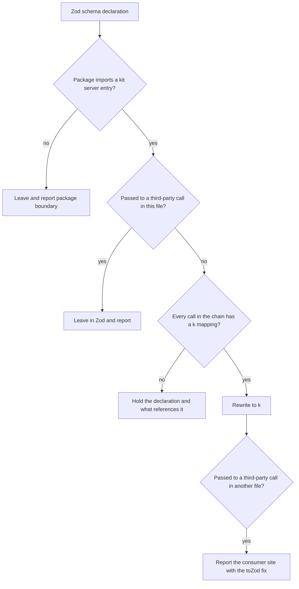

# cvx-kit 2.0.0-beta.7 Trial Gaps - Plan

## Goal Capsule

- **Objective:** An app team can move from cvx-kit 0.1.x to 2.0 with the codemod and the guide and get either correct code or an explicit report entry, never a schema that silently validates the wrong thing.
- **Means:** beta.7 fixes the defects the Accord and one-office trials found in `k`, the codemod, `toZod` and the guide (KTD1–KTD7).
- **Product authority:** the kit owner (Angel Lopez).
- **Execution profile:** one pull request, the open ImRLopezAG/cvx-kit#77 on branch `plan/v2-native-validators`. Units run in dependency order and each is committed with its tests green.
- **Stop conditions:** evidence that `toZod` cannot carry refinements without a second Zod import in the core (KTD6); or a fix in U1–U4 that changes a stored shape or a native validator of an existing schema.
- **Finishes the work:** the executor implements U1–U14 and returns. Publishing to npm, the PR body and the trial notifications happen after code review, as KTD9 states.
- **Standing limits:** npm `beta` dist-tag only and `latest` stays at 0.1.35; no merge; Accord, one-office and `/Users/angel/dev/cvx-perf` are read-only; no `"use node"` in Convex code; `.env` files are never read, printed or committed; no `git stash`.

---

## Product Contract

### Summary

beta.7 closes the gaps two real-app trials found on beta.6.
`k` stops accepting inputs it then mishandles, the codemod stops emitting code that is wrong or does not compile, `toZod` becomes usable for packages that share schemas with Zod consumers, and the guide covers what the trials had to discover.
The beta.4–beta.6 changes also get the independent review they never had.

### Problem Frame

Both trials judged beta.6 shippable only with conditions.
The worst class of defect is silent: `obj.pick({ a: true })` returns an empty object schema, `obj.partial({ a: true })` makes every field optional, and `k.enum('abc')` accepts the single characters.
Nothing fails until data that should have been rejected is stored, or data that should have passed is refused.

The codemod has the same class.
It rewrites Zod schemas that an oRPC router in the same file consumes, emits `k.isoDateTime({ offset: true })`, which does not compile, and drops the `zid` import while 24 `zid(...)` calls remain.

one-office also owns schemas in a shared package that both Convex functions and Zod-only libraries read.
`toZod` today drops `refine`, `check`, `overwrite`, `transform` and `pipe`, and emits `zod/mini` only, so a `k` schema cannot yet stand in for those Zod schemas.

Three commits (`ea938d7`, `2d82475`, `ffac0b7`) shipped as beta.4–beta.6 without independent review.

### Key Decisions

- **Shared schemas are written in `k` and reach Zod consumers through `toZod`.** (session-settled: user-approved — chosen over keeping Zod as the source of truth with a Zod-to-`k` import path or Zod-typed core APIs: v2's premise is that the kit core has no Zod.) Governs R7, R8, R10, R21.
- **beta.7 scope is the trial defects, the review debt and the listed smaller items.** (session-settled: user-approved — chosen over also adding IP formats, tuples, recursive schemas, the lifecycle workflow helper and lazy relations: none of them blocks a release.) Governs Scope Boundaries.
- **The release goes to npm under `beta` only.** (session-settled: user-directed — chosen over publishing as `latest` or merging #76 and #77: only betas are authorised.) Governs R24.

### Requirements

**`k` definitions**

- R1. `pick`, `omit`, `partial` and `required` throw a `TypeError` at definition when given a Zod-style mask object, on any `KObject` including table-derived schemas. The message names the key-list form.
- R2. `partial(...keys)` makes only the named keys optional. `partial()` and `partial(options)` keep today's behaviour, and so does `required(...keys)`.
- R3. A `k.int64()` bound given as a safe-integer number is stored as a bigint. Any other non-bigint bound throws a `TypeError` at definition.
- R4. `k.enum` accepts a non-empty array of strings or an object whose values are all strings, and yields the same schema for both. Anything else throws a `TypeError` at definition.
- R5. `decodeContract` given a bare `k` schema resolves with issues for invalid input, as `kContract` does, and does not reject.
- R6. A handler that returns nothing type-checks under `returns: k.void()`, and the registered validator is `v.null()`. `k.custom()` still refuses `undefined`.

**`toZod`**

- R7. `toZod` carries `refine`, `check`, `overwrite`, `transform` and `pipe`. For every such schema in the interop tests, the Zod schema accepts, rejects and outputs what `k` `parse` does.
- R8. `toZod` emits classic Zod when the caller supplies the classic `zod` namespace, and `zod/mini` otherwise. `src/zod.ts` stays the only file that imports Zod and has no runtime import of classic `zod`.
- R9. `.catch` stays unsupported in `toZod` with an explicit error, and the `cvx-kit/zod` entry stays under its 80,000-byte gate.

**Codemod**

- R10. A Zod schema passed to a third-party library in the same file is left in Zod and reported. A package that imports the kit only through client entries is treated as outside the migration.
- R11. Literal masks on imported tables and on `partial`/`required` are rewritten to key lists. A mask the codemod cannot read is reported, whether the schema is local or imported.
- R12. `z.iso.datetime` and `z.iso.date` arguments, `z.instanceof(ArrayBuffer)`, `z.void()`, `z.enum(object)`, `.normalize(...)` and `.startsWith(...)` each produce `k` code that compiles and validates the same inputs, or a report entry and unchanged source.
- R13. `zodToConvex(X)` on a schema the run rewrote becomes `X.validator`, `convexToZod` is reported, and a file that still calls `zid(...)` keeps a working `zid` import.
- R14. A held statement is left entirely in its v1 form. Declarations with no reference path to the unsupported call are rewritten, and a held Zod chain that pipes into a schema the run rewrote is reported.
- R15. v1 entry names inside string literals are reported, including in files with no Zod or kit import.
- R16. The `kept` file status means the file holds at least one Zod declaration that the codemod left on purpose and listed. A file with no such declaration is not `kept`.
- R17. The remaining report defects in the research dossier (C17 report paths, the open part of C6) are fixed.

**Type depth**

- R18. `test/` holds type fixtures that reproduce TS2589 and TS2590 on the shapes the one-office report names.
- R19. Each reproduced shape either type-checks after the change or is listed in the guide with its measured limit and a workaround.

**Review, docs and release**

- R20. An independent reviewer reads `ea938d7^..ffac0b7`, and every finding it confirms is fixed with a test or recorded in the PR body.
- R21. The guide and references cover G1–G9 from the one-office report, that contract results reject unknown keys, the shared-schema pattern, the `import * as z from 'zod'` form, and every report code this plan adds.
- R22. The approval poll in the packed-components smoke waits on a deadline and exits early when the workflow fails.
- R23. The app-load bundle stays within the current 255 KB budget, and the budget file is not raised.
- R24. `2.0.0-beta.7` is published under the `beta` dist-tag after the full verification matrix passes. `latest` is unchanged, #77's body covers beta.4–beta.7, and both trial threads are told.

### Acceptance Examples

- AE1. **Covers R1.** Given `const o = k.object({ a: k.string(), b: k.string() })`, when code calls `o.pick({ a: true })`, then a `TypeError` is thrown at that call.
- AE2. **Covers R2.** Given the same `o`, when code calls `o.partial('a')`, then `{ b: 'x' }` parses and `{ a: 'x' }` fails on `b`.
- AE3. **Covers R4.** `k.enum({ A: 'a', B: 'b' })` parses `'a'` and rejects `'A'`. `k.enum('abc')` and `k.enum({ A: 1 })` throw at definition.
- AE4. **Covers R10.** Given a file that declares `const Input = z.object({...})` and calls `os.input(Input)` with `os` imported from `@orpc/server`, when the codemod runs, then `Input` is unchanged and the report lists it.
- AE5. **Covers R13.** Given a file whose only kit import was `zid` from `cvx-kit/zod-table` and which keeps a held `zid('users')` call, when the codemod runs, then the output still resolves `zid`.

### Scope Boundaries

- No new `k` kinds beyond `k.void()`.
- `toZod` does not gain `.catch` support (R9).
- `pick`/`omit` with a key the object does not have keep today's behaviour. TypeScript already rejects it, and both trials hit masks, not unknown keys. A report of a runtime-only caller hitting this would change the call.
- The bundle-size check is not added to CI. The release procedure runs it. A second budget overrun that reached a release would change the call.
- No type-instantiation budget is added.

#### Deferred to Follow-Up Work

- IP formats, tuples and recursive schemas (2.1).
- The lifecycle workflow helper (2.1).
- Lazy relations, lazy table derivations and the `defineRelations` type cost (2.1).
- Accord's `--boundary-only` codemod flag, input-side JSON Schema for `.catch` and post-normaliser bounds, and a `{ recheck: true }` name for the derive guard.
- Merging #76 and #77, and the stable 2.0 release.

### Dependencies / Assumptions

- The trial reports are read-only inputs: `docs/cvx-kit-v2-trial.md` in the one-office worktree `/Users/angel/dev/t3/one-office/chore-cvx-kit-v2-beta-t-dbec1f1c3aef288d` and in the Accord worktree `/Users/angel/dev/t3/accord/chore-cvx-kit-v2-beta-p-fc395f65f0641349`.
- Accord's written report lists `toZod` as correct. The request for classic output and carried refinements came from its thread and is carried here as a settled decision.
- `convex-helpers/server/zod4` exports `zid` across the peer range. U8 verifies this before relying on it.
- `k.isoDateTime()` accepts offsets by default. U7 verifies this before dropping `{ offset: true }`.

### Open Questions

- **Deferred to implementation.** K5 was never reduced below one-office's 88-table registry. U6 decides between a fix and a documented limit once a fixture reproduces it (R19).
- **Deferred to implementation.** G4 contradicts the reason the guide gives today. U11 checks the behaviour on a local backend before rewording.

### Sources / Research

- Kit dossier, with file and line for every `k`, `toZod`, type-depth, smoke and bundle claim: `/tmp/compound-engineering-501/ce-plan-research/35fbebd4/repo-research-kit.md` (machine-local, best effort).
- Codemod and trial dossier, with each report item quoted and reproduced: `/tmp/compound-engineering-501/ce-plan-research/35fbebd4/repo-research-codemod.md` (machine-local, best effort).
- Prior plan: `docs/plans/2026-11-26-0157-feat-v2-native-validators-plan.md`.

---

## Planning Contract

### Key Technical Decisions

- KTD1. **Masks throw; they are not supported.** `maskKeys` in `src/k/object.ts` treats any trailing object as options, which is how a mask slips through. A trailing object throws when it has a key that is not a known option, or a known option whose value has the wrong type. A field that shares both the name and the value type of an option cannot be told apart from options; `k.md` names that case. Supporting masks would add an overload to four methods on the hottest type in the kit, and the codemod already rewrites literal masks.
- KTD2. **`int64` bounds normalise at definition.** `KInt64.min`/`max` coerce a safe-integer number with `BigInt()` and throw on everything else, before the chain link is created. Parse, JSON Schema and `toZod` then see bigints only, so no downstream file changes. The public types stay `bigint`.
- KTD3. **`k.enum` normalises an object to its values.** `enumOf` guards with `Array.isArray`, takes `Object.values` of a plain object, and requires every value to be a string. Numeric TypeScript enums are refused because their reverse mapping would add keys as values.
- KTD4. **`decodeContract` checks for a `k` schema before the legacy `parse` branch.** A schema with `~safeParseStrict` takes the path `kContract` uses. Other objects with `parse` keep throwing, so only bare `k` schemas change behaviour. The foundation and workflow callers keep surfacing invalid input as the structured `ConvexError` with code `VALIDATION` and its issues that `KValidationError` gives them today, and the Effect caller fails with the typed error `kContract` already produces.
- KTD5. **`k.void()` is a typing device over `v.null()`.** Convex serialises `undefined` as `null` and the kit never parses returns, so only `ReturnValueFor` in `src/registration.ts` has to accept a handler that returns nothing. Clients see `null`. `k.void()` is for `returns` only: in an args or field position its parse would accept a missing value that its `v.null()` validator refuses.
- KTD6. **Classic Zod is injected, not imported.** `toZod(schema, { zod })` builds with the namespace the caller passes; without it the converter uses its own `zod/mini` import. One converter serves both because the two namespaces share every function it uses except `minimum`/`maximum`, where `gte`/`lte` exist on both. The `zod/mini` default is an explicit table of the functions the converter calls, never the namespace import used as a value, which would pull all of `zod/mini` and its locales into the entry. (session-settled: user-approved — chosen over a Zod-to-`k` import path or Zod-typed core APIs: the kit core has no Zod.) Cites R7, R8.
- KTD7. **The codemod finds Zod consumers by use, not by a library list.** A schema is consumed by Zod when it appears inside an argument of a call whose callee chain roots at a third-party import. The chain is followed through member access, intermediate calls and local `const` initialisers, so `const procedure = os.$context()` followed by `procedure.route(...).input(...)` counts. The argument may be a schema binding, an inline `z.` expression, or a binding referenced inside one. Third-party means a bare specifier other than `zod`, `cvx-kit*`, `convex*` and `convex-helpers*` that U14's resolver does not map to the app's own source. In the same file the schema and what it references stay in Zod. Across files the schema is still rewritten and the consumer site is reported with the `toZod` fix, which is the pattern R21 documents.
- KTD8. **The 255 KB budget is a cap for beta.7.** The measured bundle is 250.5 KB, and U1–U3 add code to core files. An overrun is recovered in the code, not by raising `scripts/bench/app-load-budget.json`.
- KTD9. **Publishing follows review.** U13 prepares the release and proves it. The npm publish, the #77 body and the trial notifications run once review fixes are committed, CI is green, and every row of the Verification Contract has passed again on that final head. The publish is a manual `npm publish --tag beta` of the packed tarball. No `v*` tag is pushed, because `.github/workflows/release.yml` publishes a pushed `v*` tag as `latest`.

### High-Level Technical Design

New and changed `k` surface:

| Call | beta.6 | beta.7 |
|---|---|---|
| `o.pick({ a: true })`, `o.omit({ a: true })` | empty pick, nothing omitted | throws at definition |
| `o.partial({ a: true })`, `o.required({ a: true })` | every field affected | throws at definition |
| `o.partial('a', 'b')` | every field optional | only `a` and `b` optional |
| `k.int64().min(0)` | stored as number | stored as `0n` |
| `k.int64().min(1.5)`, `.min(NaN)`, `.min('0')` | accepted | throws at definition |
| `k.enum({ A: 'a' })` | throws at parse | same schema as `k.enum(['a'])` |
| `k.enum('abc')` | enum of characters | throws at definition |
| `k.void()` | absent | `v.null()` validator, handler may return nothing |
| `toZod(s)` with `refine` | refinement dropped | refinement carried |
| `toZod(s, { zod })` | absent | classic Zod schema |

What the codemod does with a Zod schema:

### Assumptions

- The reviewer for U10 is a model that did not write the reviewed commits.
- A behaviour change in `decodeContract` for bare `k` schemas is acceptable in a beta, since the documented throw was the defect K8 reports.
- The Effect caller failing with a typed error for a bare `k` schema, where it dies today, is the consistent reading of K8. The changelog lists it as breaking.

### Sequencing

U10 starts first because its findings may touch files that U1–U9 and U14 also edit.
U1–U4 are independent of each other.
U7 waits on U1, U2 and U3 because it emits the forms they add, and U7–U9 wait on U14 for cross-file knowledge.
U11 waits on every unit that changes behaviour, and U13 is last.

### Risks & Dependencies

| Risk | Mitigation |
|---|---|
| A mask throw breaks an app that passed a real options object | The throw fires only on keys that are not known options; U1 tests every documented option |
| Carried transforms change the inferred output type of `toZod` | U5 adds type assertions for input and output on transformed schemas |
| KTD7 flags an app's own helper imported through a tsconfig alias or a workspace package | U14 resolves both to app source; U9 fixtures include a relative, an alias and a workspace import |
| The `cvx-kit/zod` entry has about 2 KB under its gate before `k.void()` and U10 fixes | U5 measures the built entry last among the units that touch `src/zod.ts`; KTD6's explicit function table keeps locales out |
| Core additions exceed 255 KB | U12 measures after U1–U3 land, before the release unit |
| `test/parity/` snapshots are frozen v1 output | No unit regenerates them; a parity failure is a real regression |

---

## Implementation Units

| Unit | Title | Primary files | Depends on |
|---|---|---|---|
| U10 | Independent review of beta.4–beta.6 | `tools/codemod-v2/`, `src/k/`, `src/json-schema.ts` | none |
| U1 | Masks and keyed `partial` | `src/k/object.ts` | none |
| U2 | `int64` bounds and `k.enum` forms | `src/k/kinds.ts` | none |
| U3 | `k.void()` | `src/k/kinds.ts`, `src/registration.ts` | none |
| U4 | `decodeContract` on bare `k` schemas | `src/modules/contracts/contract.ts` | none |
| U5 | `toZod` refinements and classic output | `src/zod.ts` | none |
| U6 | Type-depth reproductions and fix | `src/k/object.ts`, `src/k/types.ts` | U1 |
| U14 | Codemod alias and workspace resolution | `tools/codemod-v2/index.mjs` | none |
| U7 | Codemod mappings and masks | `tools/codemod-v2/transforms/schema.mjs`, `transform.mjs` | U1, U2, U3, U14 |
| U8 | Codemod bridges, imports and report | `tools/codemod-v2/transforms/imports.mjs`, `index.mjs` | U14 |
| U9 | Codemod Zod consumers and holds | `tools/codemod-v2/transform.mjs`, `index.mjs` | U7, U8, U14 |
| U11 | Guide and references | `skills/cvx-kit/references/` | U1–U9, U14 |
| U12 | Smoke poll and bundle check | `scripts/smoke-packed-components.mjs` | U1–U3 |
| U13 | Release preparation | `package.json`, `CHANGELOG.md` | all |

### U10. Independent review of beta.4–beta.6

- **Goal:** Find defects in the three unreviewed commits before more code lands on them.
- **Requirements:** R20.
- **Dependencies:** none.
- **Files:** whatever the findings touch, chiefly `tools/codemod-v2/restore-strict.mjs`, `tools/codemod-v2/index.mjs`, `tools/codemod-v2/transforms/schema.mjs`, `src/k/kinds.ts`, `src/k/parse.ts`, `src/k/formats.ts`, `src/json-schema.ts`, `src/zod.ts`, `src/table.ts`, and their tests.
- **Approach:** A reviewer that did not write the commits reads the diff `ea938d7^..ffac0b7` with the changelog sections for beta.4–beta.6 as the stated intent. Each finding is confirmed with a failing test before it is fixed. Findings that are not fixed are written to the PR body draft.
- **Test scenarios:**
  - Each confirmed finding gets a test that fails on `ffac0b7` and passes after the fix.
  - Test expectation for the review itself: none — it produces findings, not behaviour.
- **Verification:** The review's findings list exists, and every entry is marked fixed with its test or recorded as residual.

### U1. Masks and keyed `partial`

- **Goal:** `KObject` derivation methods reject masks and `partial` can take keys.
- **Requirements:** R1, R2; AE1, AE2.
- **Dependencies:** none.
- **Files:** `src/k/object.ts`, `test/k-object-masks.test.ts` (new), `test/k-types.ts` or the nearest existing `test/*-types.ts` for the `partial(...keys)` type.
- **Approach:** KTD1 owns the throw. `partial(...keys)` mirrors the keyed `required` and its `KRequiredObject` type. The mask check runs before `derivedChecks`, so a mask can no longer skip the dropped-checks guard.
- **Execution note:** Start with failing tests for the four mask calls; they pass silently today.
- **Patterns to follow:** `required(...keys)` and `maskKeys` in `src/k/object.ts`; single-cast helpers such as `retyped` with a `// SAFETY:` comment.
- **Test scenarios:**
  - Covers AE1. `pick({ a: true })`, `omit({ a: true })`, `partial({ a: true })` and `required({ a: true })` each throw a `TypeError` whose message names the key-list form.
  - Covers AE2. `partial('a')` on `{ a, b }` parses `{ b: 'x' }` and fails `{ a: 'x' }` on `b`.
  - `partial()` still makes every field optional, and `partial(options)` with each documented option still works.
  - A known option key with a value of the wrong type throws as a mask.
  - `required('a')` after `partial()` still requires only `a`.
  - A table-derived schema from `kTable` throws on a mask the same way.
  - An object with object-level checks still throws the dropped-checks error on `pick('a')`, and a mask throws the mask error first.
  - Type level: `partial('a')` infers `a` optional and `b` required; `partial('zzz')` is a type error.
- **Verification:** The new test file passes, and no existing `k` or table test changes its expectations.

### U2. `int64` bounds and `k.enum` forms

- **Goal:** `k.int64()` bounds and `k.enum` arguments are valid or refused at definition.
- **Requirements:** R3, R4; AE3.
- **Dependencies:** none.
- **Files:** `src/k/kinds.ts`, `test/k-int64-bounds.test.ts`, `test/k-enum-forms.test.ts` (new).
- **Approach:** KTD2 and KTD3 own the rules. The object form of `k.enum` infers the union of the object's value types.
- **Patterns to follow:** the existing definition-time `length === 0` check in `enumOf`.
- **Test scenarios:**
  - `k.int64().min(0)` rejects `-1n` and accepts `0n`, and its JSON Schema and `toZod` output match those of `.min(0n)`.
  - `.min(1.5)`, `.min(NaN)`, `.min('0')` and `.min(2 ** 60)` each throw a `TypeError` at definition.
  - `.max(...)` follows the same rules.
  - Covers AE3. `k.enum({ A: 'a', B: 'b' })` parses `'a'`, rejects `'A'`, and has the validator, JSON Schema and `toZod` output of `k.enum(['a', 'b'])`.
  - `k.enum('abc')`, `k.enum({})`, `k.enum({ A: 1 })` and `k.enum([])` throw at definition.
  - Type level: the object form infers `'a' | 'b'`.
- **Verification:** Both test files pass.

### U3. `k.void()`

- **Goal:** A handler that returns nothing can declare its return.
- **Requirements:** R6.
- **Dependencies:** none.
- **Files:** `src/k/kinds.ts`, `src/k/index.ts`, `src/k.ts`, `src/registration.ts`, `src/json-schema.ts`, `src/zod.ts`, `test/k-void.test.ts` (new), `test/registration-types.ts` or the nearest existing registration type test.
- **Approach:** KTD5 owns the design. JSON Schema emits `null`, and `toZod` emits a schema that accepts `null` and `undefined`.
- **Test scenarios:**
  - `k.void().validator` is `v.null()`.
  - `k.void().parse(undefined)` and `.parse(null)` succeed, and `.parse(0)` fails.
  - Type level: a `query` with `returns: k.void()` and a handler with no return statement type-checks; a handler returning a string does not.
  - `k.custom().parse(undefined)` still fails.
  - A function registered with `returns: k.void()` whose handler returns nothing resolves to `null` in the convex-test harness the registration tests already use.
- **Verification:** The new tests pass and `k.void` appears in the public export list test.

### U4. `decodeContract` on bare `k` schemas

- **Goal:** `decodeContract` and `kContract` agree on a bare `k` schema.
- **Requirements:** R5.
- **Dependencies:** none.
- **Files:** `src/modules/contracts/contract.ts`, `test/contracts-decode.test.ts` or the existing contracts test file.
- **Approach:** KTD4 owns the branch order. The three callers (`src/modules/foundation/foundation.ts`, `src/modules/contracts/workflow.ts`, `src/modules/effect/schema.ts`) are changed to read the issues and surface them as KTD4 states.
- **Test scenarios:**
  - `decodeContract(k.object({ a: k.string() }), { a: 1 })` resolves with issues naming `a`.
  - The same call with valid input resolves with the value.
  - Unknown keys in the input produce an issue, as with `kContract`.
  - An object with only a throwing `parse` method still rejects.
  - Each of the three callers behaves as before on valid input.
  - A foundation command and a workflow contract declared with a bare `k` schema still throw a `ConvexError` with code `VALIDATION` and the issue paths on invalid input.
  - The Effect caller with a bare `k` schema fails with the typed error `kContract` produces, not a defect.
- **Verification:** The contracts tests pass, including the existing ones for the Standard Schema branch.

### U5. `toZod` refinements and classic output

- **Goal:** A `k` schema with refinements converts to an equivalent Zod schema, in `zod/mini` or classic Zod.
- **Requirements:** R7, R8, R9.
- **Dependencies:** none.
- **Files:** `src/zod.ts`, `test/zod-interop.test.ts`, `test/bundle-no-zod.test.mjs`, `test/zod-interop-types.ts` (new or the nearest existing type test).
- **Approach:** KTD6 owns the design. The existing assertion that refinements are dropped is inverted. Research measured the entry at 77,899 bytes with these four ops carried and static imports, against the 80,000-byte gate; the gate is not raised.
- **Patterns to follow:** the existing op switch in `src/zod.ts` and how `policyOf` reads chain records.
- **Test scenarios:**
  - A schema with `refine` rejects in Zod the input `k` rejects, with the `k` message.
  - A schema with `check` adding two issues yields two Zod issues.
  - A schema with `overwrite` (trim) outputs the overwritten value from Zod `parse`.
  - A schema with `transform` outputs the transformed value, and one with `pipe` validates the second stage.
  - A refinement nested inside an object field, an array element and a union branch is carried.
  - `toZod(s, { zod })` with the classic namespace returns a schema with classic methods (`.optional()` exists) that accepts and rejects the same inputs.
  - `toZod(s)` without options still returns a `zod/mini` schema.
  - A schema with `.catch` throws the existing explicit error under both outputs.
  - Type level: input and output types of a transformed schema match `k`'s inferred input and output, for both outputs.
  - `test/bundle-no-zod.test.mjs` still finds `src/zod.ts` as the only Zod importer and no runtime import of classic `zod`.
- **Verification:** The interop tests pass, and the built `cvx-kit/zod` entry is under 80,000 bytes.

### U6. Type-depth reproductions and fix

- **Goal:** The depth errors one-office hit are reproduced in the repo and removed or documented.
- **Requirements:** R18, R19.
- **Dependencies:** U1, because it changes the `KObject` method types.
- **Files:** `test/k-extend-depth-types.ts` (new), `test/effect-query-engine-types.ts` (new), `src/k/object.ts`, `src/k/types.ts`, and `src/querying.ts` or `src/modules/effect/query.ts` if the second cause is there.
- **Approach:**
  1. Write fixtures from the shapes quoted in the codemod dossier: chained and nested inline `.extend`, and a generated registry near 88 tables with a query-engine handle in an Effect query context.
  2. Confirm each fixture fails on the current head with the reported code.
  3. Try the candidates in the kit dossier: a cheaper result type for `.extend` than `Flat<Omit<F, keyof E> & E>`, and a non-nesting form of `KAnyDiffers`.
  4. Keep a fixture as a passing regression test when fixed. Otherwise record its measured limit for U11.
- **Execution note:** A fix must not change any inferred type the existing `test/*-types.ts` files assert.
- **Patterns to follow:** `test/client-filter-types.ts`, the one prior depth regression test.
- **Test scenarios:**
  - A chain of 40 `.extend` calls type-checks, where today it fails near 33.
  - 16 nested inline `.extend` links type-check, where today TS2590 appears at 13.
  - The registry fixture with the engine handle type-checks, or is committed as an expected-error fixture with the limit stated.
  - Existing type tests still pass unchanged.
- **Verification:** `bun run typecheck` passes with the new fixtures in the program, and the instantiation count from `node scripts/bench-app-load.mjs --types`, recorded before the unit starts and after it ends, is not higher.

### U14. Codemod alias and workspace resolution

- **Goal:** The run's cross-file knowledge reaches files imported through tsconfig aliases and workspace packages.
- **Requirements:** R10, R11, R13.
- **Dependencies:** none.
- **Files:** `tools/codemod-v2/index.mjs`, `tools/codemod-v2/fixtures/`, `test/codemod-v2.test.mjs`.
- **Approach:** The resolver in `runKnowledge` follows only specifiers that start with `.`. It also resolves a specifier that matches `compilerOptions.paths` of the nearest tsconfig, following `extends`, and one that names a workspace package of the same repository. A specifier it cannot resolve stays unknown, as today. KTD7 uses the same resolver to decide what is third-party.
- **Patterns to follow:** the existing relative resolver and the temp-tree tests in `test/codemod-v2.test.mjs`.
- **Test scenarios:**
  - In a temp tree with `paths: { "@backend/*": ["./src/*"] }`, a table imported as `@backend/tables` is known to the importing file.
  - A tsconfig that `extends` a base file with the `paths` resolves the same way.
  - A schema exported by a workspace package `@app/shared` in the same repository is known to an importer in another package.
  - A bare specifier that matches neither stays unresolved and nothing is assumed about it.
  - A wildcard alias with two candidate directories resolves to the first that exists.
- **Verification:** `test/codemod-v2.test.mjs` passes with the new temp-tree cases.

### U7. Codemod mappings and masks

- **Goal:** The listed Zod forms and masks produce correct `k` code or a report.
- **Requirements:** R11, R12.
- **Dependencies:** U1, U2, U3, U14.
- **Files:** `tools/codemod-v2/transforms/schema.mjs`, `tools/codemod-v2/transform.mjs`, `tools/codemod-v2/fixtures/` (new cases), `test/codemod-v2.test.mjs`.
- **Approach:**
  1. `iso` factories check their arguments: `{ offset: true }` is dropped once the assumption about `k.isoDateTime()` is verified, and any other argument is reported and the call held.
  2. `z.instanceof(ArrayBuffer)` becomes `k.bytes()` with an informational code, since the validator narrows from `v.any()`.
  3. `z.void()` maps to `k.void()` only in a `returns` position; elsewhere it is held and reported. `z.enum(X)` with an object becomes `k.enum(X)` only when the run resolves `X` to an object literal or TypeScript enum whose values are all string literals; otherwise the call is held and reported. `.normalize(f)` and `.startsWith(s)` get mappings or reports as the kit supports them.
  4. Mask handling consults `ctx.imported` with the run's table and `k` knowledge in both places that today check local bindings only.
  5. Literal masks on `partial` and `required` become key lists. A non-literal mask is reported for local and imported schemas alike, without holding the statement.
- **Patterns to follow:** `FACTORIES`, `formatOptionsMap` and `customArgumentsMap` in `transforms/schema.mjs`; `addSkip`, `addManual` and `addInfo` in `transforms/sites.mjs`; fixtures as `fixtures/<case>/{input.ts, expected.ts, expected.report.json}`.
- **Test scenarios:**
  - `z.iso.datetime({ offset: true })` becomes `k.isoDateTime()`; `z.iso.datetime({ precision: 3 })` and `z.iso.date('msg')` are held and reported.
  - `z.instanceof(ArrayBuffer)` becomes `k.bytes()` with the informational code; `z.instanceof(Date)` is still reported as custom.
  - `z.void()` in a `returns` position becomes `k.void()`; `z.void()` as an object field is held and reported.
  - `z.enum(Status)` with an all-string object literal or string enum becomes `k.enum(Status)`.
  - `z.enum(X)` with a numeric enum, a mixed object, or an imported binding the run cannot resolve is held and reported.
  - `importedTable.commandInput.pick({ name: true })` becomes `.pick('name')` in a temp-tree run where the table is rewritten in another file.
  - `schema.partial({ a: true })` becomes `.partial('a')`, and `schema.required({ a: true })` becomes `.required('a')`.
  - `importedTable.commandInput.omit(mask)` with a variable mask is reported and the statement is otherwise rewritten.
  - Every `expected.ts` in the new fixtures compiles against the built kit in the existing fixture type-check, where one exists.
- **Verification:** `test/codemod-v2.test.mjs` passes with the new fixtures.

### U8. Codemod bridges, imports and report

- **Goal:** convex-helpers bridges, `zid`, v1 strings and report statuses are handled.
- **Requirements:** R13, R15, R16, R17; AE5.
- **Dependencies:** U14.
- **Files:** `tools/codemod-v2/transforms/imports.mjs`, `tools/codemod-v2/transform.mjs`, `tools/codemod-v2/transforms/types.mjs`, `tools/codemod-v2/index.mjs`, `tools/codemod-v2/fixtures/`, `test/codemod-v2.test.mjs`.
- **Approach:**
  1. Track `zodToConvex` and `convexToZod` from `convex-helpers/server/zod4`. `zodToConvex(X)` becomes `X.validator` when the run knows `X` is `k`; otherwise it is reported. `convexToZod` is always reported.
  2. When `zid(...)` calls remain after the rewrite, the import moves to `convex-helpers/server/zod4` instead of being dropped.
  3. Files with no Zod or kit import are scanned for v1 entry names in string literals and reported; they are never rewritten.
  4. `kept` is assigned only as R16 defines.
  5. C17: report paths are written relative to the project root, not the working directory. C6: the `type-helper-unknown` report no longer fires on derived schemas that are not Zod.
- **Test scenarios:**
  - `zodToConvex(Schema)` with `Schema` rewritten in the same run becomes `Schema.validator`, and the unused import is removed.
  - `zodToConvex(External)` with an unknown schema is unchanged and reported.
  - `convexToZod(v.string())` is unchanged and reported.
  - Covers AE5. A file with a held `zid('users')` call and no other kit import keeps a resolving `zid` import.
  - A file where every `zid(...)` call was rewritten to `k.id(...)` has no `zid` import left.
  - A test file with `vi.mock('cvx-kit/zod-table')` and no imports is reported with the v1-entry code and unchanged.
  - A file holding only `z.output<typeof External>` has a status other than `kept`.
  - A file with one held Zod declaration has status `kept` and lists it.
  - A run started from a subdirectory writes the same report paths as one started from the project root.
  - A `z.output<typeof derived>` on a `k` schema derived from a table produces no `type-helper-unknown` entry.
- **Verification:** `test/codemod-v2.test.mjs` passes, and a second run over the output of the first reports no change.

### U9. Codemod Zod consumers and holds

- **Goal:** The codemod leaves alone what a Zod library needs, and holds no more and no less than it must.
- **Requirements:** R10, R14; AE4.
- **Dependencies:** U7, U8, U14.
- **Files:** `tools/codemod-v2/transform.mjs`, `tools/codemod-v2/index.mjs`, `tools/codemod-v2/fixtures/`, `test/codemod-v2.test.mjs`.
- **Approach:**
  1. KTD7 owns the consumer rule. The same-file hold covers the schema and every schema it references.
  2. The package boundary also excludes a package whose only kit imports are client entries such as `cvx-kit/react`. `--include-packages-without-kit` overrides it, as it does for the existing boundary.
  3. The hold group is the set of declarations connected to the unsupported call by schema references in either direction, which is what `decideComponents` already computes, and it is not narrowed. A characterization fixture pins it. Fewer holds come from U7's mappings.
  4. A held table keeps its v1 factory name and callback form.
  5. A held Zod chain that pipes into an imported schema the run rewrote is reported with a code that sets a non-zero exit, since the output cannot type-check.
- **Execution note:** Add characterization fixtures for the current hold behaviour before changing it.
- **Test scenarios:**
  - Covers AE4. A schema passed to `os.input(...)` from `@orpc/server` stays in Zod and is reported; an unrelated schema in the same file is rewritten.
  - The trial shape: with `const procedure = os.$context()` inside a function, `procedure.route({...}).input(z.object({ params })).output(Out)` leaves the inline object, `params` and `Out` in Zod and reports them.
  - A builder imported from a relative file that re-exports a third-party builder is followed when the run can resolve it, and reported as unproven when it cannot.
  - A schema passed to a helper imported through a tsconfig alias or a workspace package of the same repo is rewritten.
  - A schema referenced by the consumed schema also stays in Zod.
  - A schema passed to a function imported from a relative path is rewritten.
  - A schema passed to `defineTable` or a kit registration call is rewritten.
  - In a temp tree, a shared schema rewritten in one file and passed to an oRPC call in another is rewritten, and the consumer site is reported with the `toZod` fix.
  - A package whose sources import only `cvx-kit/react` is skipped with the boundary code; with `--include-packages-without-kit` it is processed.
  - A file with one unsupported call and a declaration that shares no schema reference with it rewrites that declaration.
  - A schema that a held statement embeds stays in Zod.
  - A held table is byte-identical to its input.
  - A held chain piping into a rewritten imported schema is reported and the run exits non-zero.
- **Verification:** `test/codemod-v2.test.mjs` passes, and the temp-tree tests cover both trial shapes.

### U11. Guide and references

- **Goal:** A reader of the guide meets none of the trial's surprises.
- **Requirements:** R19, R21.
- **Dependencies:** U1–U9, U14.
- **Files:** `skills/cvx-kit/references/migration-v2.md`, `skills/cvx-kit/references/k.md`, `README.md`, `CHANGELOG.md`.
- **Approach:** Each of G1–G9 is answered where the dossier shows the guide is silent or wrong. New sections cover the shared-schema pattern with `toZod` and classic output, the `import * as z from 'zod'` form with the measured 737 KB against 194 KB, that contract results reject unknown keys, and any type-depth limit U6 records. The report-code table gains every code U7–U9 add and the `kept` definition.
- **Test scenarios:** Test expectation: none — documentation. `bun run skills:check` validates the references.
- **Verification:** `bun run skills:check` passes, and every report code emitted by the codemod sources appears in the guide's table.

### U12. Smoke poll and bundle check

- **Goal:** The packed-components smoke stops failing on a slow workflow, and the bundle is confirmed inside its budget.
- **Requirements:** R22, R23.
- **Dependencies:** U1–U3.
- **Files:** `scripts/smoke-packed-components.mjs`.
- **Approach:** The approval poll takes the deadline form the same script already uses for its 60-second loop, and exits at once with the workflow's error when the execution reports failure. KTD8 owns the budget rule.
- **Test scenarios:** Test expectation: none — a smoke script. Its own run is the proof.
- **Verification:** `scripts/smoke-packed-components.mjs` passes locally, and `bun run bench:app-load` reports a bundle at or under 255 KB with `scripts/bench/app-load-budget.json` unchanged.

### U13. Release preparation

- **Goal:** The head is a proven `2.0.0-beta.7`.
- **Requirements:** R24.
- **Dependencies:** all other units.
- **Files:** `package.json`, `CHANGELOG.md`.
- **Approach:** Bump the version, write the beta.7 changelog section, opening with a list of what breaks for an app on beta.6 (the definition-time throws of R1, R3 and R4 and the `decodeContract` change of R5), and run the full matrix in the Verification Contract. KTD9 owns what follows.
- **Test scenarios:** Test expectation: none — packaging. The verification matrix is the proof.
- **Verification:** Every row of the Verification Contract passes on the release commit.

---

## Verification Contract

| Check | Command | Applies to |
|---|---|---|
| Build | `bun run build` | every unit that touches `src` |
| Unit tests | `vp test run --exclude test/package-contents.test.mjs` | every unit |
| Lint | `vp lint` | every unit |
| Types | `bunx tsc --noEmit -p .` (errors in `test/effect-auth-types.ts` mean a stale `dist`; rebuild) | every unit |
| Skills | `bun run skills:check` | U11 |
| Format | `vp fmt` on changed files only | every unit |
| Packed and real-backend scripts | `test-packed-ids`, `-variants`, `-variant-querying`, `-oxlint`, `-effect`, `-auth`, `-querying`, `smoke-packed-effect`, `smoke-packed-components`, each with `HOME=/tmp/cvxm/home` | U13 |
| App-load bench | `bun run bench:app-load` | U6, U12, U13 |

The packed and real-backend scripts run in the background with a long timeout, and no source file is edited while they run.
The time budget of `bench:app-load` is only meaningful at a low machine load; the bundle size is not load-dependent.

---

## Definition of Done

- Every requirement R1–R23 is met and covered by a test named in its unit, except where the unit states that no test applies.
- R24's preparation is complete: version `2.0.0-beta.7`, changelog written, verification matrix green on the release commit.
- No `test/parity/` snapshot was regenerated.
- `src/zod.ts` is still the only file that imports Zod.
- No lint rule is disabled without the reasoned disable line the repo requires.
- Code from approaches that were tried and dropped, in U6 especially, is not in the diff.
- Each unit is its own commit, or a small group of commits, with its tests green.
